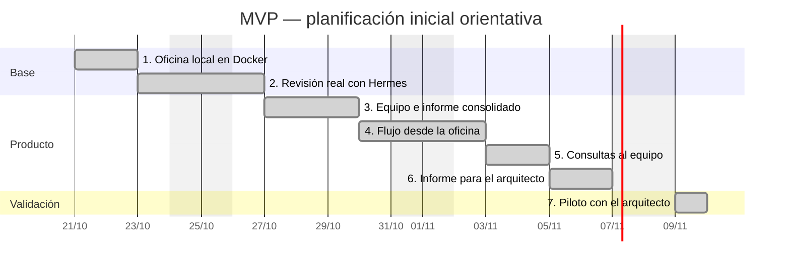

# Plan MVP — Oficina de agentes para revisión de repositorios

## Objetivo
Aprender a utilizar Hermes Agent y Hermes3D con un caso útil: entender una aplicación y entregar al arquitecto un resumen breve para valorar su posible migración a VPS o Kubernetes. El arquitecto decide y solicita las verificaciones adicionales.

## Entrada y alcance
- Única entrada del usuario: URL del repositorio de GitHub. El acceso al repositorio y al modelo se configura en la instalación.
- Buscar primero `main`; si no existe, analizar `master`. Registrar rama y commit revisados. Si faltan ambas, informar de que no hay `main` ni `master`; los errores de acceso o conexión no activan el cambio de rama.
- Revisión de lectura acotada: estructura, documentación, manifiestos, configuración Docker y archivos de código relevantes. Indicar los archivos revisados y las exclusiones.
- Una ejecución activa. No ejecutar la aplicación analizada, instalar sus dependencias, hacer tests, modificar código ni desplegarla.

## Equipo y resultado
Coordinador → tres células → resumen consolidado → arquitecto.

| Célula | Revisión mínima |
|---|---|
| Seguridad | Acceso, configuración y posibles secretos evidentes, sin mostrar sus valores |
| Arquitectura y migración | Componentes, arranque, Docker, almacenamiento y conexiones; implicaciones observables para VPS o Kubernetes |
| Inventario tecnológico | Tecnologías, versiones declaradas, dependencias directas y servicios identificados |

El coordinador reúne la evidencia, ejecuta las revisiones y elimina duplicados. Las células pueden ejecutarse secuencialmente.

## Informe para el arquitecto
Estándar implementado en la fase 6: un único `informe.md`, breve y comprensible para el responsable técnico, generado desde los resultados separados de las tres células. El coordinador organiza y elimina duplicados; no añade conclusiones nuevas. Los agentes no editan simultáneamente el documento final.

El foco es seguridad, continuidad, estabilidad, recursos y condiciones de operación y gobernanza identificables en lo revisado. Las malas prácticas de código se incluyen solo cuando tienen una consecuencia concreta para estos aspectos. No se certifica seguridad ni se autoriza el despliegue.

### Plantilla del documento final
```markdown
# Evaluación preliminar de iniciativa

## Contexto
- Proyecto y propósito documentado:
- Repositorio, rama seleccionada y commit:
- Fecha y estado de las células: completadas o revisión parcial.

## 1. Resumen para el responsable técnico
Qué hace la aplicación según la evidencia disponible, principales riesgos
observados e información que falta para evaluar su incorporación a TI.
Incluir solo hechos respaldados; separar explícitamente los indicios.

## 2. Cómo está construida
| Componente | Tecnología declarada | Función identificada | Evidencia |
|---|---|---|---|

Explicar brevemente arranque, comunicaciones y almacenamiento.
Distinguir relaciones confirmadas de interpretaciones por comprobar.

## 3. Puntos que requieren atención
### [Título concreto del hallazgo]
- Área: seguridad / continuidad / operación.
- Certeza: confirmado en repositorio / indicio por confirmar.
- Qué se encontró:
- Por qué importa:
- Qué falta verificar o corregir:
- Evidencia: archivo:línea.
- Agente de origen:

## 4. Estabilidad, recursos y gobernanza
| Aspecto | Evidencia disponible | Información o validación pendiente |
|---|---|---|

Cubrir persistencia, recuperación, estabilidad, CPU/memoria, capacidad,
servicios externos, acceso a datos y responsabilidades, cuando sea posible.
Declarar lo desconocido sin asumir que un control o responsable no existe.

## 5. Implicaciones para la migración
- Elementos que facilitarían el traslado, con evidencia.
- Cambios o condiciones identificados.
- Preguntas pendientes para valorar destino y esfuerzo.

## 6. Alcance y límites
- Archivos revisados y exclusiones principales.
- Células que finalizaron y posibles fallos.
- Comprobaciones no realizadas.
- Referencia al detalle de evidencia.
```

### Aportaciones y trazabilidad
- **Inventario:** componentes, tecnologías, versiones declaradas y dependencias; distinguir declaración de uso comprobado.
- **Arquitectura:** arranque, datos, continuidad, estabilidad, configuración de recursos e implicaciones de migración. No presentar consumo o capacidad reales sin mediciones.
- **Seguridad:** acceso, exposición, configuración sensible y controles documentados. La gobernanza no acreditada por el repositorio queda como pregunta para el responsable.
- **Coordinador:** reunir esas aportaciones en las secciones de la plantilla y agrupar pendientes sin duplicados, manteniendo fuente y agente de origen.

Conservar los archivos actuales `celulas/security.json`, `celulas/architecture.json` y `celulas/inventory.json` como resultados separados, y `evidencia.json` con commit, cobertura y citas completas. El arquitecto debe poder leer el resumen sin abrir estos archivos.

### Reglas de contenido
- Cada espacio se completa con evidencia o «no determinado en esta revisión»; no rellenar con recomendaciones genéricas. Las dudas concretas van junto al aspecto o condición de migración correspondiente, conservando su origen.
- Mantener separados confirmados, indicios y dudas. Una posible implicación es condicional; una cita válida no demuestra por sí sola que la interpretación sea correcta.
- Referencias breves `archivo:línea` como enlaces a GitHub fijados al commit revisado, y citas completas en la evidencia. Priorizar lo que afecta datos, acceso y operación, sin inventar urgencias, puntuaciones de preparación ni estimaciones de esfuerzo o recursos.
- Lectura estática parcial: no confundir células completadas con repositorio revisado íntegramente, controles operativos verificados o despliegue seguro. La ausencia de hallazgos no acredita seguridad ni la ausencia de un componente.
- Objetivo de extensión: una o dos páginas equivalentes, dejando el detalle en los archivos de la revisión. Mantener el límite por célula: hasta 2 confirmados, 1 indicio y 2 dudas.

## Base técnica
Reutilizar Hermes3D con oficina **2D por defecto** y conectar Hermes Agent para las revisiones reales. Empezar con el modo demo identificado como tal y comprobar pronto la integración real.

Arrancar la solución local con Docker Compose: interfaz y motor de análisis separados, informes persistentes y credenciales fuera de las imágenes. Mantener los contenedores sin privilegios y sin acceso al socket Docker. Reutilizar gráficos y animaciones; adaptar el mapa a los equipos que existan.

## Fases y seguimiento
Cada fase entrega una funcionalidad comprobable. Estimación orientativa total: catorce días laborables, con cinco días para las fases 5–7. Fechas ilustrativas si se empieza el 21/10/2026; no representan avance real.

| Fase | Funcionalidad completa | Terminada cuando… | Estimación | Estado |
|---|---|---|---|---|
| 1 | Oficina local en Docker | Hermes3D arranca con Compose y permite explorar una demo claramente identificada | 2 días | Completada y verificada (20/10/2026) |
| 2 | Primera revisión con Hermes Agent | Recibe una URL, lee `main` o `master` según disponibilidad, registra rama y commit y devuelve observaciones con evidencia usando el runtime real | 2 días | Completada y verificada (20/10/2026) |
| 3 | Equipo e informe consolidado | Las tres células producen un único informe con confirmados, indicios y dudas | 3 días | Completada y verificada (20/10/2026) |
| 4 | Flujo completo desde la oficina | Permite iniciar el análisis, ver estados reales y descargar el informe; muestra fallos sin ocultarlos | 2 días | Completada y verificada (20/10/2026) |
| 5 | Consultas mínimas al equipo | Desde una revisión terminada, pulsar un personaje permite preguntar sobre su resultado y evidencia; responde con fuentes o reconoce que falta información | 2 días | Completada y verificada (20/10/2026) |
| 6 | Informe comprensible para el arquitecto | Un único informe sigue la plantilla acordada, conserva resultados por célula y explica riesgos, operación y migración con fuentes y grados de certeza; el usuario valida su utilidad | 2 días | Completada y verificada (20/10/2026) |
| 7 | Piloto validado por el arquitecto | Tras validar las fases 5 y 6, se revisa el repositorio objetivo y el arquitecto confirma la utilidad del informe y las consultas para su evaluación manual | 1 día | Completada y validada por el usuario (20/10/2026) |



**Avance:** fases 1–7 completadas; piloto validado por el usuario con bookingApi. Verificado desde la oficina 2D: iniciar una revisión nueva de Hermes3D con acceso autenticado a GitHub, leer `main` en el commit `beb76292747b816ef317aa6f9a3992e0014f81d9`, mostrar estados reales y abrir y descargar el informe. La recarga del navegador conservó la revisión. Las tres células finalizaron con Luna/low: 3 llamadas, 15462 tokens reportados por Hermes, sin reintentos ni resultados reutilizados. Evidencia e informe: `reports/254eaa96-b200-46c2-8a7f-3dd6d7e1df62/`. Compilación y 28 pruebas superadas; comprobados rechazo de URLs con ramas y solicitudes de otro origen, errores visibles y publicación solo en localhost. Operación en `README.md`. Fases 6 y 7 validadas por el usuario; las fechas del Gantt son orientativas.

## Fase 5 — Consultas mínimas
- Seleccionar una revisión terminada, completa o parcial, y pulsar Coordinador, Seguridad, Arquitectura o Inventario para abrir una pregunta y respuesta breve. Mostrar siempre qué revisión, commit y agente se consultan.
- Cada célula recibe únicamente su resultado y la evidencia que revisó. El coordinador responde dudas generales con el informe consolidado y sus fuentes; esta consulta sí requiere modelo, aunque la consolidación siga siendo por código.
- Una pregunta independiente por envío, sin historial largo ni conversación entre agentes. Consultar solo al personaje elegido, heredando el perfil económico; no relanzar el equipo, releer GitHub ni ejecutar herramientas. Serializar las consultas con las revisiones para conservar una ejecución activa.
- Citar las fuentes utilizadas y distinguir explicación, indicio y dato ausente. Si una célula falló o la respuesta no está en la evidencia, indicarlo. Mostrar errores sin reintentos automáticos.
- Verificar con una pregunta respaldada, otra fuera de la cobertura y un fallo de acceso al modelo. La consulta no modifica el informe original.

**Verificación de fase 5 (20/10/2026):** apertura desde tarjetas y personaje 2D, dos consultas reales sobre la revisión guardada de Hermes3D: Seguridad respondió con fuentes y Coordinador reconoció que no había mediciones de RAM. Luna/low, 2 llamadas, 10956 tokens reportados por Hermes; sin releer GitHub ni modificar el informe. Resultados en `reports/254eaa96-b200-46c2-8a7f-3dd6d7e1df62/consultas/`. Compilación y 40 pruebas superadas, incluidas fuentes inválidas, células fallidas, fallo de acceso al modelo simulado, interrupciones y exclusión con revisiones por comando. Mejora aprobada e implementada: última pregunta/respuesta por revisión y agente conservada en la sesión de la pestaña, sin enviarla como historial. Compilación y 2 pruebas de interfaz adicionales superadas: restauración sin otra petición, aislamiento entre agentes/revisiones y envío únicamente de la pregunta actual; sin nuevas llamadas al modelo.

## Fase 6 — Claridad del informe
Implementar el estándar y la plantilla de «Informe para el arquitecto» en la generación, lectura en la oficina y descarga Markdown. Adaptar las instrucciones, el esquema de resultados y su validación para obtener observaciones, implicaciones y pendientes respaldados, antes de aumentar modelos o límites. Mantener resultados separados por célula y un único documento final; conservar las aportaciones válidas si otra célula falla.

Validar primero el ejemplo ya disponible: el usuario debe poder entender qué hace la aplicación, cómo está construida, qué riesgos afectan a datos/acceso/continuidad, qué se sabe de recursos y qué falta para evaluar su incorporación y migración. Comprobar fuentes, grados de certeza, tratamiento de datos desconocidos, resultados parciales y lectura útil sin abrir JSON. Conservar informes anteriores e identificar cualquier reformateo como derivado de la evidencia original, sin simular una revisión nueva. No iniciar el repositorio objetivo hasta aceptar el formato.

**Verificación de fase 6 (20/10/2026):** formato 2 generado sobre la evidencia guardada de Hermes3D, sin releer GitHub ni comprobar el `main` actual. Ejemplo: `reports/20261020T130733584929Z-fase6/informe.md`; originales conservados y sus hashes comprobados. Las tres células finalizaron con Luna/low: 3 llamadas, 16615 tokens reportados por Hermes, sin reintentos. Compilación y 47 pruebas superadas; comprobados fuentes, datos desconocidos, resultados parciales y compatibilidad con informes anteriores. Lectura en la oficina, enlaces al commit y descarga Markdown verificados; el archivo descargado coincide con el guardado. El usuario confirmó que el formato es útil. Al cerrar la fase 6, la fase 7 seguía sin iniciar.

## Fase 7 — Piloto
**Piloto completado y validado por el usuario (20/10/2026).** Repositorio de prueba: `https://github.com/ziuld/bookingApi`, en sustitución de la iniciativa empresarial aún no disponible. Por instrucción del usuario, el sistema busca primero `main` y utiliza `master` solo si falta `main`; informa de error si faltan ambas. Los fallos de acceso o conexión no activan el cambio de rama. Rama revisada: `master`; commit `c0d247e3226d77a83471c7a1b32afdb0981eb7f1`.

Inspección previa sin modelo y revisión iniciada desde la oficina: 12 archivos, 20801 bytes; se añadió soporte de manifiestos Gradle y del punto de entrada `Application.java` sin subir los límites. Compilación y 51 pruebas superadas. Las tres células finalizaron con Luna/low: 3 llamadas, 15832 tokens reportados por Hermes, sin reintentos. Informe: `reports/02589807-3135-4323-9409-7745b7b3fbb1/informe.md`; lectura en la oficina, enlaces al commit y descarga comprobadas. Una consulta real al Coordinador sobre los pendientes de base de datos respondió con fuentes y distinguió hechos de verificaciones pendientes: 1 llamada, 3910 tokens, sin releer GitHub ni modificar el informe. La aplicación analizada no se ejecutó ni desplegó.

El usuario confirmó que el informe y la consulta son útiles para la evaluación. Se cierra la fase 7 con bookingApi como repositorio de prueba; la iniciativa empresarial aún no se ha revisado. Esta validación acredita la utilidad del MVP y no autoriza el despliegue de la aplicación analizada.

## Oficina compacta
Implementada: cuatro puestos de análisis, sala de revisión y zona de café; mapa de 28 × 22 casillas, estilo oscuro con acento turquesa y panel separado del mapa. Compilación, 26 pruebas de mapa/movimiento/estados y lectura del informe desde el navegador verificadas, sin nuevas llamadas al modelo.

Mejora visual opcional: bocadillos breves ligados a estados reales. Añadir puestos o salas cuando se incorporen equipos reales, sin construir expansión automática.

## Después del MVP
Añadir verificaciones, tests o análisis más profundos según las dudas reales del piloto. La publicación de nuestra solución mediante Azure DevOps y Kubernetes se abordará después; la migración de la aplicación analizada seguirá su propia evaluación humana.

**Cierre documental (20/10/2026):** README general y guías de instalación, flujo, operación y preparación del repositorio en `docs/`; versiones fijadas, parche y avisos de terceros conservados. Exclusiones de Git y enlaces locales comprobados. Fuentes reconstruidas localmente desde los commits originales y el parche, con construcción de ambas imágenes y 51 pruebas superadas, sin llamadas al modelo. La instalación en otro ordenador y la subida a un remoto siguen sin ejecutarse.

## Perfil económico para la prueba objetivo
Mínimo recomendado inicialmente: **gpt-6-luna con razonamiento low**, usando OAuth de ChatGPT. Es el modelo que ya produjo un informe real en este piloto; no se ha demostrado todavía que sea suficiente para el repositorio objetivo. La cuota de la suscripción y la facturación API son distintas.

Configuración ajustable en `.env`: `AUDIT_MODEL=gpt-6-luna`, `AUDIT_REASONING=low`, `AUDIT_MAX_FILES=12`, `AUDIT_MAX_TOTAL_BYTES=48000`. Cada célula recibe hasta 6 archivos/24 KB y devuelve hasta 2 confirmados, 1 indicio y 2 dudas. `AUDIT_MAX_OUTPUT_TOKENS=2500` solicita un techo por célula en modo API; esta versión de Hermes no lo envía al backend Codex OAuth, por lo que con Plus la brevedad depende de las instrucciones y no es un límite duro de salida. No hay un presupuesto total de tokens garantizado. El prompt, las instrucciones internas y el razonamiento también consumen contexto. La validación de citas se hace con código.

Seguridad, arquitectura e inventario heredan ese mismo modelo/razonamiento. Se puede ajustar una sola célula mediante las variables opcionales de `.env.example`. El coordinador distribuye evidencia y consolida mediante código, sin una llamada adicional al modelo. El informe identifica fuentes y células; conserva resultados si otra falla, declara cobertura parcial y no resuelve contradicciones semánticas automáticamente.

Antes de la prueba objetivo: ejecutar `--inspect-only` y revisar si los archivos seleccionados cubren arranque, dependencias, Docker y datos. Si faltan archivos, ajustar primero la selección o subir hasta 20 archivos/90000 bytes. Si la evidencia es suficiente pero la interpretación es deficiente, probar Luna con `medium`; considerar Sol solo para la célula que lo necesite. No aumentar modelos ni repetir llamadas automáticamente. Comparar utilidad y citas con el arquitecto antes de conservar un ajuste.
