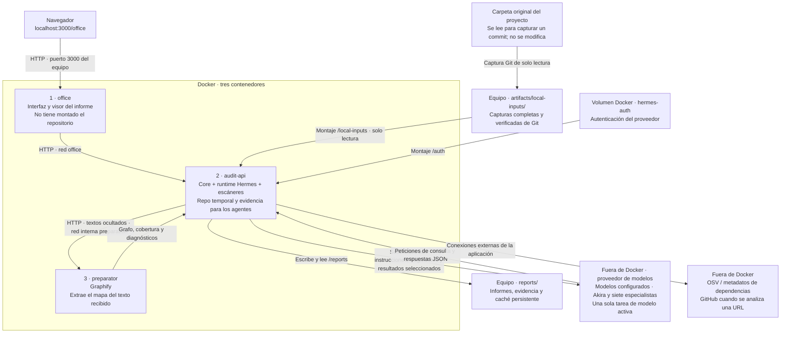

# Dónde vive cada cosa

Configuración actualizada el 30/10/2026. Tres contenedores: `office`, `audit-api` y `preparator`. Coordinación centralizada y ejecución secuencial; sin Redis.

## Acceso de los agentes

Los modelos no se ejecutan dentro de Hermes ni reciben un disco montado. Hermes es el runtime que realiza las llamadas al proveedor desde `audit-api`.

Core dispone de la captura completa, incluidos los archivos binarios para inventario y herramientas compatibles. Los especialistas pueden solicitar cualquier archivo de texto disponible, aunque Graphify no reconozca su lenguaje. Core entrega fragmentos con referencias verificables y posibles secretos ocultos. Los límites actuales son 200 archivos y 600.000 bytes por especialista, con consultas por regiones; eso no garantiza una lectura completa. El coordinador sintetiza las aportaciones validadas, sin investigar archivos directamente.

## Almacenamiento

| Contenido | Lugar | ¿Se conserva al recrear el contenedor? |
|---|---|---|
| Proyecto original | La carpeta indicada por el usuario, fuera de Docker | Sí; la aplicación no la modifica |
| Captura del commit | `artifacts/local-inputs/<id>/`, montada en Core como `/local-inputs/<id>/` | Sí |
| Copia de trabajo del repositorio | Directorio temporal de `audit-api`, bajo `/tmp/arktic-snapshots-…/` | No; se elimina al terminar o reiniciar |
| Texto ocultado para consultas de los especialistas | Memoria de Core durante el análisis; copia persistente en la caché de preparación | Sí en la caché; no en memoria |
| Trabajo temporal de Graphify | `/tmp/` de `preparator` | No; devuelve el resultado a Core antes de limpiar |
| Grafo, resultados deterministas y artefactos de herramientas | `/reports/` de Core, enlazado a `reports/` del equipo | Sí |
| Preparación reutilizable | `/reports/.preparation-cache/`, enlazado a `reports/.preparation-cache/` del equipo | Sí |
| Revisiones, hechos, referencias, tareas y métricas | `/reports/.knowledge/office.sqlite`, transacciones gestionadas por Core | Sí |
| Artefactos comunes y espacios de especialistas | `/reports/.knowledge/artifacts/<identidad>/` y `<ejecución>/agents/<id>/` | Sí |
| Informe HTML, Markdown, JSON y evidencia revisada | Carpeta propia de cada ejecución dentro de `/reports/` | Sí |
| Sesión de autenticación | Volumen Docker `hermes-auth`, montado como `/auth` en Core | Sí mientras se conserve el volumen |
| Estado propio de la interfaz | Volumen Docker `studio`, montado como `/data/hermes` en `office` | Sí mientras se conserve el volumen |

La caché permite volver a ejecutar los agentes con modelos o instrucciones diferentes sin repetir los escáneres ni Graphify. Se invalida si cambian repositorio, commit, inventario o herramientas/configuración relevante, incluido el JSON de reglas Semgrep. Las consultas externas OSV tienen una vigencia propia de 24 horas por defecto (`AUDIT_VULNERABILITY_MAX_AGE_SECONDS`). El informe conserva la fecha de la preparación reutilizada. `AUDIT_PREPARATION_REFRESH=1` fuerza su regeneración. No se reutilizan conclusiones de modelos como si fueran una ejecución nueva.

La interfaz recibe el catálogo y el estado desde Core por HTTP. SQLite no se monta en `office`; los modelos consultan contexto seleccionado por Core. Las consultas se encolan y comparten la exclusión de actividad con las revisiones. Los fallos globales detienen nuevas llamadas y los reinicios marcan interrupciones sin reintentar un resultado remoto desconocido.

## Límites de red efectivos

- `preparator` solo está en la red interna `preparation`; no tiene salida directa a Internet.
- `audit-api` está en `preparation` y en `office`. `office` es una red bridge con `internal=false`: no hay una lista de destinos de salida que lo limite a los modelos.
- `office` también está en esa red bridge. Las restricciones de destinos de su proxy son controles de aplicación, no un cortafuegos general de Docker.
- Core y Graphify no publican puertos en el equipo. El frontend publica `127.0.0.1:3000` y accede a Core desde Docker.
- Los agentes tienen sus herramientas de navegador, terminal y red deshabilitadas. Sus consultas se resuelven por Core; esta restricción de herramientas no equivale a bloquear la red del contenedor.
- Los modelos son externos y reciben la evidencia seleccionada en sus solicitudes. OSV consulta servicios externos y la adquisición desde GitHub requiere red. La revisión local no necesita un servicio de alojamiento Git para leer una captura ya preparada.

Graphify está instalado en la imagen mediante `uv tool install graphifyy[sql]==0.9.97`, con la skill de Hermes registrada dentro de ella. El adaptador actual genera un mapa estático; registrar la skill no ejecuta por sí solo una pasada semántica con IA.
