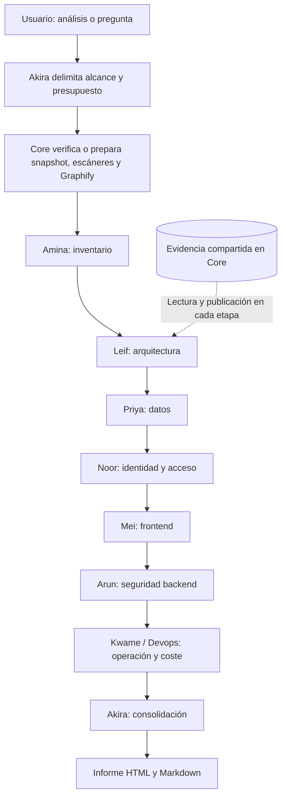

# Plan único de mejoras — Coordinación centralizada

Fecha: 30/10/2026. Estado: implementado con resultados y límites comprobados. La comparación inicial no demostró mejora; la prueba posterior de mapas reduce el consumo, pero no demuestra conservar la profundidad de Arquitectura y Devops. Chromium aplazado por indicación del usuario.

Este es el único plan de trabajo de Arktic Office. Sustituye el antiguo plan de fase 3, el prompt externo de agentes reutilizables y las alternativas anteriores de concurrencia. MVP y fases cerradas se conservan exclusivamente como histórico. El cierre publicado `76abf0f` es el punto de referencia para la implementación descrita aquí.

## 1. Objetivo y decisiones

Mejorar la cobertura y la eficiencia de la investigación, conservando el informe actual que ha funcionado. Las prioridades ejecutivas son vulnerabilidades, seguridad y riesgos de coste al desplegar en Azure. Inventario, arquitectura y datos aportan información que evita repetir investigaciones. Todas las preguntas siguen formando parte del análisis, incluidas las de operación y persistencia.

- Mantener las **40 preguntas Q01–Q40, sin añadir, suprimir ni reformular ninguna**. Cambiar su reparto por especialidad y compartir sus evidencias.
- Coordinación centralizada por Akira; ejecución **secuencial**, con una sola tarea de modelo activa cada vez, incluidas las consultas posteriores.
- Reutilizar hechos y preparación válidos; no enviar todos los informes a todos los modelos.
- Los especialistas pueden investigar problemas adicionales a sus preguntas. Todos los hallazgos confluyen en una única sección del informe.
- No añadir un segundo revisor automático, reparación automática de citas ni una batería de aplicaciones vulnerables. Decisión actualizada por el usuario el 31/10/2026: retirar también el filtro determinista de contenido y referencias. Se conserva únicamente la recepción técnica de los datos, los presupuestos, el acceso acotado a archivos y el escape HTML. Akira consolida; no juzga ni reescribe las respuestas de los especialistas.
- Mantener los tres contenedores, sin Redis, nuevos servicios, cambios de modelos ni ampliaciones de CI/CD en este alcance.
- Cada nuevo perfil tendrá persona, escritorio, estado y panel de consulta en el frontend.

## 2. Qué tomamos del estudio de Google

[Google Research: Towards a science of scaling agent systems](https://research.google/blog/towards-a-science-of-scaling-agent-systems-when-and-why-agent-systems-work/).

El estudio compara agentes únicos y equipos independientes, centralizados, descentralizados e híbridos. Sus resultados señalan que la descomposición y las dependencias del trabajo importan más que aumentar el número de agentes. La coordinación tiene un coste y puede perjudicar tareas con razonamiento secuencial muy conectado.

Nuestra decisión es una aplicación de esas observaciones: Akira distribuye encargos acotados y conserva una vista común; cada especialista sigue completo el recorrido que está investigando. Elegimos ejecución secuencial para aprovechar los resultados previos y controlar recursos. **Google no demuestra que nuestra secuencia vaya a gastar menos tokens**, ni prescribe esta plantilla o este número de especialistas. El ahorro se comprobará con métricas de nuestro sistema.

No se desarrollarán ahora ejecución paralela, conversación entre todos los agentes ni una arquitectura híbrida. Consultar evidencia publicada por otro especialista no implica iniciar una conversación con su modelo.

## 3. Perfiles, preguntas y orden de trabajo

| Orden | Persona y nombre visible | Perfil técnico propuesto | Responsabilidad | Preguntas principales |
| --- | --- | --- | --- | --- |
| Apertura y cierre | Akira · Coordinador | coordinator | Delimitar encargos, resolver dependencias y consolidar riesgos, protecciones y discrepancias | Q01–Q03, Q38–Q40 |
| 1 | Amina · Inventario | inventory | Lenguajes, versiones, tecnologías y servicios externos; publicar hechos reutilizables | Q04–Q06 |
| 2 | Leif · Arquitectura | architecture | Tipo de aplicación, componentes, entradas, conexiones y límites de confianza | Q07–Q09 |
| 3 | Priya · Datos | data | Almacenes, caché, conservación, copias y datos personales | Q10–Q14 |
| 4 | Noor · Seguridad | identity | Identidad, permisos, sesiones, contraseñas y limitación de intentos | Q23–Q27 |
| 5 | Mei · Seguridad frontend | frontend-security | Cookies, XSS, secretos del navegador y consentimiento | Q28–Q31 |
| 6 | Arun · Seguridad backend | backend-security | Entradas y operaciones del servidor, secretos, datos salientes y consumo abusivo; contrastar alertas de dependencias aplicables | Q32–Q37 |
| 7 | Kwame · Devops | devops | Construcción, Docker, CI/CD, conexiones, despliegue, exposición y riesgos de consumo/coste | Q15–Q22 |

Ocho perfiles habituales contando al coordinador. Arun se denomina **Seguridad backend** y Kwame mantiene **Devops**. No se incorpora un perfil Hacker ni un tester adicional. El nombre Hacker se reserva para un especialista con alcance propio de investigación de vías de ataque: acceso indebido a bases de datos, afectación a usuarios y otras posibles vulnerabilidades explotables. No es otro nombre para Seguridad backend ni implica que se hayan realizado ataques o pruebas activas. Zola no se activa como etapa de validación en este alcance.

El orden coloca inventario y arquitectura primero. Datos y permisos ayudan a los análisis posteriores; Devops puede aprovechar los recorridos y operaciones costosas encontrados por los demás. Una consulta posterior específica usa únicamente los perfiles necesarios y los resultados vigentes, sin repetir automáticamente toda la secuencia.

Akira asigna cada pregunta exactamente una vez como responsabilidad principal. Los demás pueden aportar evidencia, sin generar respuestas competidoras innecesarias. Q38–Q40 se aplican a cada problema: el autor entrega defensas, condiciones, impacto y pendientes; Akira consolida esas aportaciones. No constituyen otra pasada completa de modelos ni una certificación independiente.

Si una comprobación no aplica, se conserva su pregunta y una explicación respaldada. No se activa una llamada para rellenar un tema claramente ajeno a la revisión. La ausencia de backend en este repositorio no demuestra por sí sola ausencia de APIs externas ni de funciones de servidor dentro de un framework frontend.

## 4. Información centralizada y persistente

Se mantiene la topología actual:

| Contenedor | Contenido y responsabilidad |
| --- | --- |
| office | Interfaz y animación. Consulta Core por HTTP; no abre directamente la base ni el repositorio |
| audit-api | Core, Hermes, especialistas, planificación, búsquedas y escritura de la información compartida |
| preparator | Extracción de Graphify mediante el adaptador instalado |

Ubicación propuesta, aprovechando el montaje persistente existente `./reports` del host a `/reports` en Core:

```text
reports/
  .preparation-cache/             Preparación compatible reutilizable
  .knowledge/
    office.sqlite                Revisiones, hechos, referencias, tareas, estados y métricas
    artifacts/<revision-key>/    Resultados grandes referenciados desde SQLite
  <fecha>/<proyecto>/<run-id>/
    agents/<agent-id>/
      assignment.json            Preguntas, alcance y presupuesto del encargo
      notes.md                   Notas locales de investigación
      result.json                Respuestas, hallazgos y referencias
      summary.md                 Resumen consultable de esta aportación
    estado.json                  Exportación compatible para el historial actual
    celulas/                     Exportaciones compatibles de resultados
    informe.html
    informe.md
```

Core controla las transacciones y las exportaciones. Las notas no se convierten automáticamente en hechos confirmados. Los modelos consultan mediante herramientas delimitadas; no reciben SQL arbitrario ni permisos para sobrescribir el resultado de otro especialista.

La base contiene identidad del repositorio, commit, huella de captura, hechos con procedencia, referencias a archivos/líneas, versiones de herramientas y reglas, preguntas, estado, dependencias, hallazgos y métricas. Se separan observaciones, hipótesis, protecciones verificadas e incidencias técnicas. Decisión actualizada el 31/10/2026: no ocultar ni ofuscar el contenido de código, configuración o resultados de herramientas. Conservar los originales; el informe presenta el texto del especialista con autoría, sin segunda revisión automática.

Las capturas locales completas continúan en `artifacts/local-inputs`, montadas como `/local-inputs` de solo lectura. El código de trabajo puede extraerse temporalmente en Core. La recreación de un contenedor no borra los datos del montaje persistente; el montaje no equivale a una copia de seguridad.

### Reutilización y búsqueda

1. Consultar resultados deterministas, inventario y hechos disponibles para la revisión actual.
2. Usar Graphify y los mapas para localizar relaciones relevantes.
3. Buscar directamente en todo el texto disponible y leer código cuando sea necesario; la falta de parser no bloquea la lectura de un archivo de texto capturado.
4. Publicar hechos nuevos con referencias; una conclusión anterior orienta la búsqueda, sin sustituir la evidencia original.

Mejorar la búsqueda para consultar contenido aunque existan coincidencias en nombres de archivo, devolver localizaciones precisas y paginar por todas las coincidencias. Utilizar símbolos y relaciones cuando estén disponibles. Ampliar las reglas locales de seguridad según las tecnologías detectadas y conservar cobertura y límites por herramienta.

Mantener la caché de preparación independiente del modelo. Verificar identidad e integridad antes de reutilizar; cambios de captura, herramientas o reglas relevantes invalidan los derivados afectados. Auditar que se incluyan también los archivos de reglas JSON que se utilicen. La información externa de vulnerabilidades necesita una política de vigencia propia y renovación manual explícita.

Las conclusiones de modelos tienen una identidad separada: revisión, encargo, instrucciones y perfil efectivo. Al volver a comparar modelos se reutiliza la preparación, pero se generan nuevas respuestas. No se reutilizan como resultados de la nueva prueba las conclusiones que se pretende comparar.

## 5. Flujo secuencial y comunicación



Cada etapa lee y publica en la misma base; la flecha de evidencia ilustra esa relación, no una excepción exclusiva para Arquitectura. Las etapas no aplicables se resuelven sin llamada al modelo, conservando las preguntas y su justificación. Las respuestas visibles mantienen su orden temático, aunque el orden de ejecución sea distinto.

Las consultas pasan por Core y Akira. Primero se busca un hecho ya publicado; si falta, se crea una investigación acotada para el responsable. No se despierta al modelo de otro agente para devolver un dato que Core ya puede recuperar. Si la consulta necesita un especialista posterior, Core evita dependencias circulares y registra el pendiente; el investigador puede leer el código directamente dentro de su alcance.

Antes de cerrar una pregunta sensible, seguir el recorrido aplicable: entrada, identidad, permiso, operación y destino de los datos. Registrar qué se comprobó y qué defensa se encontró. No partir cada paso de ese mismo razonamiento entre varios agentes.

### Fallos, esperas y presupuesto

| Situación | Comportamiento |
| --- | --- |
| Error de captura o falta de integridad | Detener la ejecución antes de consumir modelos |
| Herramienta de mapa sin soporte para un lenguaje | Registrar el límite y permitir búsqueda/lectura directa; no afirmar ausencia de funcionalidad |
| Especialista falla | Guardar sus aportaciones válidas y bloquear únicamente tareas que necesiten resultados ausentes; continuar las independientes |
| Evidencia directa permite continuar | El siguiente especialista investiga su alcance, sin inventar lo que falló |
| Credenciales del proveedor, acceso global o presupuesto agotados | Detener nuevas llamadas y mostrar el motivo |
| Referencia no localizable | Conservar íntegros el texto, el estado y la referencia indicados por el especialista; localizar lo posible para presentación, sin descartar la respuesta ni repararla con modelos |
| Reinicio o conexión perdida | Registrar interrupción/estado desconocido; no repetir automáticamente una llamada cuyo resultado remoto se desconoce |

Establecer presupuesto total por revisión y límites de tiempo, llamadas y contexto por tarea. El reparto no multiplica automáticamente por siete los presupuestos actuales. Registrar tokens comunicados por el proveedor, contexto reenviado y duración real; mostrar «No disponible» si faltan métricas. Los límites de proveedor que no sean duros se documentan; Core puede impedir nuevas llamadas sin prometer interrumpir una generación remota ya iniciada al token exacto.

La falta de un resultado se distingue de «no aplica». La parada identifica tarea, motivo, aportaciones conservadas y condición necesaria para continuar. No hay bucles indefinidos ni reintentos automáticos repetidos.

## 6. Panel compacto y oficina

- Catálogo único de perfiles para backend y frontend. Ocho personas y ocho escritorios estables para los perfiles habituales.
- Tarjetas en cuadrícula adaptable al ancho: primero nombre de persona, debajo rol; actividad breve, modelo, esfuerzo, duración y tokens disponibles. Mostrar resultado resumido y un error breve visible cuando exista.
- Indicador de carga solo durante ejecución real. Diferenciar en cola, investigando, esperando, finalizado y error; cobertura y ejecución son conceptos separados.
- Al pulsar tarjeta o avatar se abren detalles y la consulta. Retirar de la tarjeta las instrucciones completas del rol y los avisos genéricos largos; no ocultar errores relevantes.
- Las consultas durante una revisión se encolan y no crean una segunda llamada simultánea. Mostrar «En cola» hasta que comiencen.

| Estado real | Comportamiento del personaje |
| --- | --- |
| Ejecutando una investigación o respuesta | Va a su escritorio y se sienta |
| Síntesis final del informe en curso | Participa en la reunión visual: sentado en la sala o en su escritorio si no hay plaza |
| En cola o esperando una dependencia | Disponible de pie o descansando, sin aparentar ejecución |
| Finalizado | Se levanta y conserva su resultado consultable; durante la síntesis final permanece en la reunión hasta que el informe esté listo |
| Bloqueado o error | Deja de aparentar trabajo y muestra el motivo |
| Nueva consulta comienza a ejecutarse | Regresa y se sienta hasta terminar |

Akira se sienta al repartir o responder y participa sentado en la reunión de síntesis. Mientras no tenga tarea propia activa permanece disponible de pie, aunque otros estén trabajando. La animación no inicia llamadas al modelo.

### Reunión final de síntesis

Al comenzar la síntesis o resumen final, Core publica un estado específico de reunión para la revisión activa. El frontend representa una sesión de videoconferencia tipo Teams, vinculada a ese estado real:

1. Reservar a Akira una plaza en la sala y asignar las demás plazas libres a los especialistas que participaron en esta revisión. La capacidad la determinan los asientos accesibles del mapa; no apilar personajes ni inventar plazas.
2. Los participantes sin plaza permanecen o regresan a sus propios escritorios y se sientan, como asistentes remotos. Los perfiles no convocados para esa revisión no se incorporan artificialmente.
3. Añadir una televisión en la sala. Se enciende durante la reunión y muestra una vista de informe compartido en preparación, participantes e iconos de micrófono silenciado. Si ya hay contenido guardado de esta revisión, se puede representar; no mostrar conclusiones aún no generadas ni datos de otra revisión.
4. Representar la puesta en común con indicadores visuales discretos de revisión o atención al informe. No inventar diálogo, atribuir afirmaciones a los agentes ni reproducir voces. La sesión permanece en silencio, sin acceso al micrófono o la cámara del usuario ni conexión a Microsoft Teams.
5. Los paneles distinguen «En reunión final» de «Ejecutando análisis». Solo las llamadas reales incrementan actividad de modelo y consumo; sentarse como participante no consume tokens ni activa de nuevo a los especialistas.
6. Cuando la generación y el guardado del informe terminan y este queda disponible para abrir y descargar, apagar la televisión, liberar las plazas y levantar a todos los participantes, incluidos los de los escritorios. La disponibilidad del informe no espera a que termine una animación ni a que todos alcancen su asiento.
7. Si la síntesis se interrumpe, se cancela o falla, terminar la reunión y mostrar la incidencia. Un informe parcial válido también finaliza la reunión al quedar guardado, conservando su estado y limitaciones. Una consulta posterior normal sienta únicamente a quien la atienda; no convoca automáticamente a todo el equipo.

Aplicar el estado a la ejecución activa, incluso si el usuario está leyendo un informe histórico. Al reconectar, recuperar la fase real desde Core. La reunión debe tener prioridad sobre el paseo de ocio y disponer de asignación de asientos estable para evitar cambios continuos de plaza.

Corregir asientos conjuntamente en mapa, simulación y render: destino accesible, anclaje del cuerpo, orientación y profundidad de dibujo. En sofás, sentarse delante del respaldo y mirando al frente; en escritorios, hacia el monitor. Reservar plazas y evitar que un asiento ocupado sea la alternativa automática.

Reducir aproximadamente a un tercio los desplazamientos de ocio. Partir de pausas de 12–30 segundos frente a las actuales 4–10 y medir la frecuencia efectiva de recorridos. Mantener la velocidad de caminar para no alargar el tiempo de paseo y permitir que un encargo interrumpa el ocio.

## 7. Informe: conservar preguntas y unificar hallazgos

- Mantener el diseño actual, la visualización directa y ambas descargas.
- Resumen ejecutivo comprensible: qué es la aplicación, riesgos prioritarios y protecciones importantes comprobadas. Máximo diez riesgos en el resumen, sin rellenar un cupo.
- Una sección de vulnerabilidades y riesgos recibe los hallazgos de preguntas, escáneres contrastados e investigación adicional. Conservar autoría y evidencia, eliminar duplicados y señalar discrepancias. Los riesgos de coste se distinguen de las vulnerabilidades.
- Conservar las 40 preguntas en el detalle, incluida la explicación de las no aplicables y los puntos verdaderamente pendientes. No inferir que algo está bien únicamente por ausencia de alertas.
- Incluir hallazgos adicionales sin inventar nuevos identificadores de pregunta ni reformular las existentes.
- Conservar los anexos deterministas explicados en lenguaje natural, sin código ni JSON públicos; originales internos accesibles para investigación.
- Mantener fuera del informe la sección de recomendaciones y los planes de remediación. Q02 conserva su pregunta sobre prioridades antes/después de desplegar.
- Redacción ejecutiva y comprensible, sin coletillas de IA. Identificadores acompañados de nombre y explicación; no prefijos mecánicos como «Parcial. No…».
- Los costes monetarios de Azure necesitan parámetros y supuestos verificables; el código puede sustentar riesgos de gasto sin permitir una factura mensual exacta.

## 8. Bloques de implementación

| Bloque | Trabajo | Comprobación para cerrar |
| --- | --- | --- |
| M1. Contratos y referencia | Fijar las 40 preguntas y su reparto; definir hechos, referencias, tareas y actividad; revisar los dos fallos legados documentados sin cambiar expectativas a ciegas | Ninguna pregunta perdida o cambiada; compatibilidad histórica definida |
| M2. Búsqueda y herramientas | Corregir búsqueda por contenido, paginación y localización; ampliar reglas; revisar invalidación y vigencia de caché | Lectura directa funciona aunque Graphify no tenga parser; preparación compatible reutilizable |
| M3. Información común | Añadir SQLite, referencias y espacios por agente; consultas selectivas y exportaciones actuales | Hechos vinculados a revisión; persisten tras recrear Core; historial anterior sigue abriendo |
| M4. Especialistas secuenciales | Integrar perfiles, preguntas, publicación por etapa, dependencias, presupuestos y paradas | Cada tarea usa aportaciones anteriores pertinentes; fallos no generan llamadas sin utilidad |
| M5. Interfaz y oficina | Catálogo dinámico, personas/escritorios, cuadrícula, detalle, estados reales, asientos, paseos y reunión final con televisión | Participantes repartidos entre sala y escritorios, pantalla en silencio y cierre al quedar disponible el informe; perfiles visibles y consultables |
| M6. Comparación y cierre | Validar informe y descargas, matriz de preguntas, consumo, tiempo y cobertura sobre alcance equivalente | Ahorro o coste adicional explicado; sin pérdida silenciosa de cobertura |

M1–M4 preceden a activar los nuevos perfiles en producción. La corrección de asientos y ocio puede prepararse de forma independiente dentro de M5. No desplegar una oficina que anuncie agentes todavía no conectados al backend.

### Estado comprobado de la implementación · 30/10/2026

| Bloque | Estado | Resultado comprobado |
| --- | --- | --- |
| M1 | Implementado | Catálogo Q01–Q40 comparado por ID y texto con la copia exacta de `76abf0f`; un responsable por pregunta. La copia de referencia conserva la huella indicada al final del plan. Se investigaron las dos expectativas legadas: huellas de prompts/formatos anteriores y diferencias de presentación de cobertura entre HTML y Markdown; no se regeneraron referencias automáticamente. |
| M2 | Implementado | Búsqueda simultánea por nombres y contenido, localizaciones y páginas de coincidencias; prioridad de definiciones del grafo sin perder las demás coincidencias. Lectura de texto sin parser. Catorce reglas Semgrep validadas; el JSON de reglas participa en la identidad de caché. Vigencia OSV de 24 horas por defecto y renovación manual existente. |
| M3 | Verificado | SQLite transaccional en `.knowledge/office.sqlite`, identidad por revisión, procedencia, hechos, tareas, estados y eventos; artefactos y espacios por agente. Tras recrear Core se conservan exactamente 8 tareas, 98 hechos y las huellas de los tres informes de la prueba real. Integridad SQLite correcta. Historial anterior y descargas conservados. |
| M4 | Implementado | Siete especialistas en el orden fijado y Akira. Contexto anterior seleccionado por preguntas pertinentes; límites globales y por tarea, parada global de proveedor, bloqueo de dependencias declaradas y conservación de aportaciones. Consultas en cola y una sola actividad de modelo; recuperación por ID de pregunta guardada sin llamada. |
| M5 | Implementado y probado en simulación; revisión visual aplazada | Catálogo servido por Core; ocho personas y escritorios, tarjetas compactas, detalle y consulta, estado de reunión, televisión silenciosa, cuatro plazas en sala y resto en escritorios. Simulación de navegación, plazas exclusivas, estabilidad y liberación correcta. Pausas 12–30 segundos: 178 recorridos frente a 456 en 600 segundos sobre el mismo mapa y con velocidad idéntica (61 % menos). Parche del sofá conservado. Chromium queda expresamente pendiente por indicación del usuario. |
| M6 | Comparación y descargas verificadas; beneficio no demostrado | Mismo commit, inventario y textos Q01–Q40, Sol/medium. La prueba pasa de 19 a 31 llamadas y de 709.084 a 1.189.320 tokens (+67,7 %); preguntas respondidas: 12 → 4, parciales: 23 → 24, no comprobadas: 5 → 12. No se oculta la regresión ni se repite automáticamente el análisis. HTML/Markdown anterior y nuevo coinciden byte a byte con los guardados; 40 anclas de pregunta en el nuevo HTML. Caché compatible comprobada sin repetir Graphify, escáneres ni modelos en la segunda lectura. |

Los resultados y las limitaciones de la entrega se recogen en `docs/RESULTADOS_COORDINACION_2026-10-30.md`. Este apartado registra verificaciones; no cambia las decisiones ni añade otro plan.

Pruebas dirigidas sobre contratos, recuperación, fallos, API y animación; revisión visual real del mapa. No relanzar un proyecto completo por cada ajuste de presentación. Comparar el sistema con la referencia actual usando el mismo repositorio, alcance y perfil de modelo; tokens más bajos con preguntas sin investigar no cuentan como mejora. La comparación no incorpora la batería de aplicaciones vulnerables descartada.

## 9. Límites y criterios de aceptación

- El código analizado sigue siendo de solo lectura y no se ejecuta ni se instalan sus dependencias.
- Los modelos reciben herramientas gestionadas por Core, sin consola general ni escritura en el repositorio original.
- Un prompt no impone aislamiento de red. El Core actual no tiene una lista de destinos salientes que lo limite exclusivamente a proveedores de modelos; este plan no promete que ya exista ni añade infraestructura de red como trabajo separado.
- Cero diferencias en IDs o textos de Q01–Q40; un responsable principal por pregunta; las no aplicables permanecen en el resultado.
- Sin mezcla de hechos de commits distintos, sin doble contabilización del presupuesto y sin estados de ejecución ficticios.
- Fallos y bloqueos visibles; resultados válidos conservados; cada parada tiene un motivo verificable.
- Informes históricos y descargas siguen disponibles. No se reescriben informes antiguos para simular análisis nuevos.
- El modelo y sus métricas reales aparecen por ejecución. Cada perfil añadido tiene persona, escritorio y consulta.
- Durante la síntesis final, la sala usa solo sus plazas libres y el resto participa desde su escritorio. Televisión encendida e indicadores de silencio; no se generan llamadas adicionales por animación. Al guardar el informe disponible para ver y descargar, o ante una interrupción, todos se levantan y la pantalla se apaga.
- Se registran duración total, llamadas, tokens informados, contexto repetido y cobertura por pregunta. No se garantiza ahorro antes de medir.

## 10. Matriz completa de las preguntas conservadas

Los textos siguientes se conservan del catálogo de referencia, incluidos sus matices. El catálogo efectivo `backend/src/arktic_office/resources/profiles/questions.json` ya aplica este reparto; `questions-reference.json` conserva exactamente el archivo de `76abf0f`. La ejecución nueva se identifica como `central-coordination-v1`; los informes históricos no se reescriben.

| ID | Responsable principal propuesto | Pregunta conservada |
| --- | --- | --- |
| Q01 | Akira — Coordinación | ¿Cuáles son las conclusiones y los problemas más importantes de los análisis solicitados? |
| Q02 | Akira — Coordinación | ¿Qué habría que resolver antes de desplegar y qué puede dejarse para después? |
| Q03 | Akira — Coordinación | ¿Qué puntos quedan sin comprobar o tienen conclusiones contradictorias? |
| Q04 | Amina — Inventario | ¿Cuál es el lenguaje principal de la aplicación y qué otros lenguajes utiliza? |
| Q05 | Amina — Inventario | ¿Qué tecnologías y frameworks principales utiliza, qué versiones tienen y para qué sirve cada uno? |
| Q06 | Amina — Inventario | ¿A qué servicios externos se conecta y para qué utiliza cada uno? Incluye servicios de inteligencia artificial y gateways de acceso a modelos. |
| Q07 | Leif — Arquitectura | ¿Qué contiene este repositorio: frontend, backend, ambos u otro tipo de aplicación? ¿Para qué sirve cada parte? |
| Q08 | Leif — Arquitectura | ¿Funciona como una sola aplicación o está dividida en servicios? ¿Cómo se conectan sus partes principales? |
| Q09 | Leif — Arquitectura | ¿Cómo organiza el código y sus responsabilidades? ¿Sigue alguna arquitectura o mezcla varias? Explica brevemente con ejemplos. |
| Q10 | Priya — Datos | ¿Qué bases de datos, archivos u otros almacenes utiliza? ¿Dónde están, qué información guardan y cuáles hay que conservar al migrar? |
| Q11 | Priya — Datos | ¿Utiliza caché? ¿Qué guarda, durante cuánto tiempo y cómo protege los datos sensibles? Contrasta la protección con Seguridad. |
| Q12 | Priya — Datos | ¿Qué datos se conservan al reiniciar la aplicación y cuáles se pierden? |
| Q13 | Priya — Datos | ¿Existe un sistema de copias de seguridad? ¿Qué guarda y cómo se recuperan los datos? |
| Q14 | Priya — Datos | ¿Qué datos personales guarda? ¿Permite consultarlos, corregirlos y eliminarlos? ¿Define cuánto tiempo los conserva? |
| Q15 | Kwame — Devops | ¿Cómo se construye y se arranca la aplicación? Identifica los comandos y scripts necesarios. |
| Q16 | Kwame — Devops | ¿Qué necesita para arrancar, como variables de configuración, bases de datos u otros servicios? |
| Q17 | Kwame — Devops | ¿Está preparada para ejecutarse con Docker o Docker Compose? ¿Qué partes se ejecutan en contenedores? |
| Q18 | Kwame — Devops | ¿Tiene procesos automáticos de integración y despliegue (CI/CD)? ¿Qué construyen, comprueban o despliegan? |
| Q19 | Kwame — Devops | ¿Los datos se conservan si se elimina o se vuelve a crear el contenedor? ¿Qué hay que configurar para conservarlos? |
| Q20 | Kwame — Devops | ¿Qué conexiones externas hay que configurar para que funcione en nuestro entorno? |
| Q21 | Kwame — Devops | ¿Está preparada para funcionar en local, en una red interna o en Internet? ¿Hay información sobre dónde está desplegada y en qué país? |
| Q22 | Kwame — Devops | ¿Qué partes pueden consumir más memoria, CPU o disco? ¿Hay límites configurados y qué habría que medir para conocer el consumo real? |
| Q23 | Noor — Seguridad: identidad y acceso | ¿Tiene un sistema de autenticación? Si existe, sigue el recorrido de una petición y explica cómo comprueba la identidad y si algún acceso sensible queda sin proteger. |
| Q24 | Noor — Seguridad: identidad y acceso | ¿Comprueba qué puede ver y hacer cada usuario? ¿Podría alguien acceder a datos de otros usuarios o realizar acciones sin permiso? |
| Q25 | Noor — Seguridad: identidad y acceso | ¿Cómo mantiene la sesión del usuario? ¿Cuándo caduca y cómo se invalida al cerrar sesión? |
| Q26 | Noor — Seguridad: identidad y acceso | ¿Dónde y cómo guarda las contraseñas de los usuarios y los tokens de sesión? ¿Están protegidos? |
| Q27 | Noor — Seguridad: identidad y acceso | ¿Limita los intentos de inicio de sesión para evitar que alguien pruebe muchas contraseñas? |
| Q28 | Mei — Seguridad frontend | ¿El frontend guarda o lee información sensible en las cookies? ¿La expone o la comparte con terceros? |
| Q29 | Mei — Seguridad frontend | ¿El frontend muestra datos que podrían ejecutar código malicioso en el navegador (XSS)? |
| Q30 | Mei — Seguridad frontend | ¿Expone claves, contraseñas o API keys privadas en el código o los archivos que recibe el navegador? |
| Q31 | Mei — Seguridad frontend | ¿Utiliza cookies que necesitan consentimiento? Si las utiliza, ¿permite aceptarlas, rechazarlas y cambiar la elección? ¿Las bloquea hasta obtener permiso? |
| Q32 | Arun — Seguridad backend | ¿El servidor genera páginas o contenido que podrían ejecutar código malicioso en el navegador (XSS)? |
| Q33 | Arun — Seguridad backend | ¿Guarda información sensible en las cookies? ¿Cómo las protege para evitar su exposición? |
| Q34 | Arun — Seguridad backend | ¿Alguien podría manipular los datos que envía para alterar las consultas a la base de datos (inyección SQL)? |
| Q35 | Arun — Seguridad backend | ¿Hay operaciones que puedan quedarse bloqueadas, repetirse sin límite o agotar los recursos? Incluye lo que ocurre si un servicio externo falla o tarda en responder. ¿Qué controles existen? |
| Q36 | Arun — Seguridad backend | ¿Dónde guarda las claves y contraseñas que utiliza para conectarse a bases de datos o servicios externos? ¿Hay secretos escritos en el código o incluidos en archivos del repositorio, como los .env? |
| Q37 | Arun — Seguridad backend | ¿Qué información envía a servicios externos? ¿Incluye datos sensibles y cómo los protege? Incluye la protección de datos sensibles en caché. |
| Q38 | Akira — Coordinación | Para cada problema señalado: ¿está sustentado por el código o hay alguna protección que lo evita? |
| Q39 | Akira — Coordinación | Para cada problema señalado: ¿qué condiciones necesita para ocurrir y qué impacto tendría? |
| Q40 | Akira — Coordinación | Para cada problema señalado: ¿qué se ha comprobado y qué falta para confirmarlo o descartarlo? |

Huella SHA-256 del catálogo de referencia: `e1ae857f1b66b64a615760d42372c14e1d8e4d51d8ff3728793fda14f47bad05`.


## Actualización de ejecución — 31/10/2026: originales sin filtro

Decisión expresa del usuario posterior al diagnóstico: eliminar la ocultación y el validador de respuestas. Esta actualización sustituye cualquier instrucción anterior de este documento sobre ocultar contenido o rechazar una conclusión por sus citas. No cambia Q01–Q40, modelos, presupuestos ni ejecución secuencial.

Implementado: entrega de fuentes sin transformación, Gitleaks sin `--redact`, resultados originales conservados, recepción de respuestas sin evaluación de citas/longitud/fundamento y sin descenso automático de su estado. Los originales completos se guardan siempre, incluso si el JSON no puede recibirse. Las referencias originales acompañan a las localizadas. HTML y Markdown incorporan un anexo con las aportaciones originales, separado de la síntesis de Akira. La caché identifica la nueva política para no reutilizar fuentes ocultadas. El acceso a rutas, integridad, límites, cola secuencial y escape de HTML siguen siendo controles técnicos.

Verificación: reproducción offline de las siete respuestas archivadas, sin proveedores: las 34 respuestas especializadas conservan exactamente texto y estado; 8 respondidas, 25 parciales y 1 no comprobada. Los HTML/Markdown de esta reproducción conservan el anexo y las 40 anclas. Se generan en `artifacts/central-coordination`, sin reescribir el análisis histórico. Este ensayo no prueba una mejora nueva de investigación ni restaura contenido ya ocultado en aquella captura. La comparación histórica M6 permanece registrada tal como ocurrió.

Suite final de la nueva política: 196 pruebas, 195 correctas y una omisión preexistente. El diagnóstico del 31/10 recoge el detalle de Arun (5 llamadas frente a 6, +0,31 % de tokens) y distingue ese coste individual del de los tres especialistas de seguridad.

Servicio actualizado y saludable. Comprobación posterior: ocho perfiles disponibles, sin revisiones activas ni reunión abierta y sin incremento de las 31 llamadas históricas. Las cuatro descargas HTML/Markdown de las dos revisiones coinciden con los archivos guardados. Los 103 archivos históricos comprobados permanecen idénticos y SQLite devuelve `integrity_check=ok`. Evidencias: `api-original-policy.json`, `download-original-policy.json`, `original-policy-persistence.json` y `backend-original-policy-release.log`, en `artifacts/central-coordination`. No se hicieron commits ni publicaciones.


## Actualización acordada — mapas y consultas locales (31/10/2026)

Se sustituye el envío anticipado de respuestas completas por un mapa determinista de preguntas publicadas en esta revisión: ID, pregunta original, autor y estado, sin respuestas ni citas. Cada especialista puede solicitar hasta cuatro IDs mediante `{"questions":["Q25","Q11"]}` dentro del mecanismo `queries` existente. Core lee SQLite, entrega los textos y estados originales y agrupa las ubicaciones de fuentes contiguas; las citas completas permanecen guardadas. Consultar información publicada no despierta a otro modelo ni habilita SQL arbitrario. Una pregunta aún no publicada devuelve su indisponibilidad; si una consulta agrupada contiene otras disponibles, esas respuestas se conservan.

Los escáneres siguen el mismo principio: mapa inicial con nombre, finalidad, estado y cantidades, sin detecciones ni salidas completas. `{"tool":"D04","index":true}` descubre ubicaciones y tipos; `tool`, `query`, `paths`, `offset` y `limit` permiten solicitar resultados pertinentes y paginados de Gitleaks, OSV y Semgrep. Se retira el envío duplicado de detecciones en el contexto común y en el contrato de salida. Los originales y anexos deterministas se conservan íntegros. La consulta de inventario y cobertura Graphify sigue disponible como D01/D05; las búsquedas de símbolos, relaciones, texto y lecturas directas de código conservan su funcionamiento.

Se usan las mismas rondas, hasta cuatro consultas locales por ronda y los mismos límites/modelos/presupuestos. Consultar mapas o SQLite no crea llamadas de revisión o resumen. El modelo puede consumir una ronda para pedir datos, por lo que no se promete ahorro total ni mejora de cobertura sin una comparación real. Las métricas de cada llamada incorporan tamaños del mapa de preguntas, mapa de herramientas, código retenido e historial solicitado.

Medición offline sobre la revisión archivada de Arun: las siete respuestas antes precargadas ocupaban 67.153 bytes por llamada; el nuevo mapa permite descubrir veinte respuestas previas con 3.850 bytes (-94,27 % frente a aquel bloque). La reconstrucción de la primera petición ocupa 30.449 bytes frente a los 114.381 registrados (-73,38 %). Es una comparación de bytes reconstruidos, no una medición de tokens nuevos. Cero llamadas a proveedores y ningún informe histórico reescrito. Evidencia en `artifacts/central-coordination/lookup-maps-measurement.json`.

Cierre de mapas comprobado: backend actualizado y saludable; 202 pruebas (201 correctas y una omisión previa), API con ocho perfiles y sin tareas activas, cuatro descargas HTML/Markdown idénticas a las guardadas, 103 archivos históricos intactos e integridad SQLite correcta. Sin llamadas reales a modelos, cambios de modelos/presupuestos, commits ni publicaciones. Chromium continúa aplazado. Evidencias finales: `backend-lookup-maps-verified.log`, `recreate-lookup-maps.log`, `lookup-maps-verification.json` y `download-lookup-maps.json`, en `artifacts/central-coordination`.


### Prueba real de mapas completada · 31/10/2026

Ejecución `813716cc-477b-4a4b-9795-a231973a4b9f`, mismo commit/inventario/Q01–Q40/Sol-medium y límites globales. Resultado: 30 llamadas, 717.849 tokens (-39,64 % frente al centralizado anterior), 874,675 segundos (-16,21 %) y 2.493.232 bytes de contexto (-40,83 %). Frente al sistema original de tres especialistas, el consumo queda +1,24 %. Se reutilizó la preparación compatible y se preservaron sus originales; no se ejecutó el proyecto objetivo.

M6 queda comprobado con resultado mixto: ahorro de contexto y tokens, sin errores técnicos, pero no se acredita mantener la profundidad de lectura. Publicado: 3 respondidas, 36 parciales y 1 no comprobada. Al comparar originales de las mismas 34 preguntas especializadas, 8 → 3 respondidas y 25 → 30 parciales: cambios en Q07–Q09 y Q15–Q16, sin intervención de un validador. Las 15 preguntas de Seguridad conservan sus estados originales con un 45,30 % menos de tokens en conjunto. Se leyeron 84 archivos frente a 100 y se realizaron 64 consultas de código frente a 79. La lectura pendiente de Arquitectura/Devops sigue siendo un límite real; no se relanza automáticamente la prueba.

Verificado: 34 respuestas originales intactas, 40 preguntas y anclas, seis descargas correctas, 103 archivos históricos sin cambios, ocho tareas y 105 hechos en SQLite con integridad correcta, reunión cerrada y presupuesto respetado. Chromium sigue aplazado. El resultado detallado y los límites de comparación se registran en `docs/RESULTADOS_MAPAS_2026-10-31.md`; es un cierre de resultados, no otro plan.


## Cierre estable y propuestas pendientes — 31/10/2026

Por instrucción expresa del usuario se guarda este punto estable mediante commit y push de la rama actual antes de hacer más cambios. No se aplica la unificación de perfiles comentada: permanecen siete especialistas y Akira, con Arquitectura y Datos separados. Estabilidad funcional no significa cobertura semántica completa. Se conservan los resultados favorables y desfavorables de las tres configuraciones en `docs/evidence/agent-comparison-2026-10-31/` y el cierre en `docs/CIERRE_COORDINACION_2026-10-31.md`.

Las siguientes propuestas quedan documentadas, **sin implementar ni activar**. Este apartado pertenece al único plan vigente; no es una autorización para nuevas ejecuciones de modelos.

| Propuesta | Motivo observado | Qué habría que comprobar antes de aceptarla |
| --- | --- | --- |
| Comparar tres especialistas con los mapas actuales y sin filtro de respuestas | La versión original tuvo consumo similar al actual y menos llamadas; las herramientas y el tratamiento de respuestas difieren | Misma captura, modelos y preguntas; presupuesto explícito; separar beneficio de las herramientas y del reparto entre agentes |
| Unificar Arquitectura y Datos en un responsable de Q07–Q14 | Son recorridos conectados: aplicación, servicios, almacenes, caché, conservación y datos personales; la separación puede fragmentar la visión | Mantener exactamente los ocho IDs/textos; un personaje, escritorio, panel y consulta funcional; compatibilidad de historiales; presupuesto dentro del techo vigente, sin aumentar modelo ni gasto global por inercia |
| Recuperar la lectura pendiente de Arquitectura y Devops | Q07–Q09 y Q15–Q16 quedaron menos concluyentes; Arquitectura cerró con una ronda disponible | Web pública, cliente/contexto tRPC, enrutador y módulos; tareas de Turborepo, paquete web, Dockerfile de migraciones e inyección de variables. Priorizar fuentes necesarias, sin consumir rondas por obligación ni añadir revisor |
| Afinar la selección y agrupación de consultas locales | SQL y escáneres ahorran contexto, pero ocuparon consultas antes usadas para código | Evitar recuperaciones redundantes y comprobar la lectura de las áreas relevantes, conservando los límites de rondas, consultas y contexto; no volver a precargar informes completos |
| Aclarar el significado de respondida/parcial en análisis estático | Una respuesta de configuración puede ser útil sin ejecutar producción; los agentes usan criterios de cierre distintos | Instrucciones claras, sin cambiar preguntas, sin reclasificar resultados guardados y sin un validador que reescriba al especialista; evaluar contenido y límites de lectura además de contar etiquetas |
| Completar Chromium cuando el usuario lo retome | Comprobación visual expresamente aplazada | Oficina, asientos, reunión/TV, paneles y descargas; la animación no debe generar llamadas a modelos |

Se mantienen las decisiones de ejecución secuencial, Core/SQLite/archivos, mapas consultables, respuestas originales, ausencia de ocultación y de un segundo validador, modelos configurados y preservación de Q01–Q40. No se ejecuta ni se instalan dependencias del repositorio analizado, ni se realizan ataques activos. Cualquier ensayo futuro requiere presupuesto definido y conserva sus resultados como una ejecución nueva.
