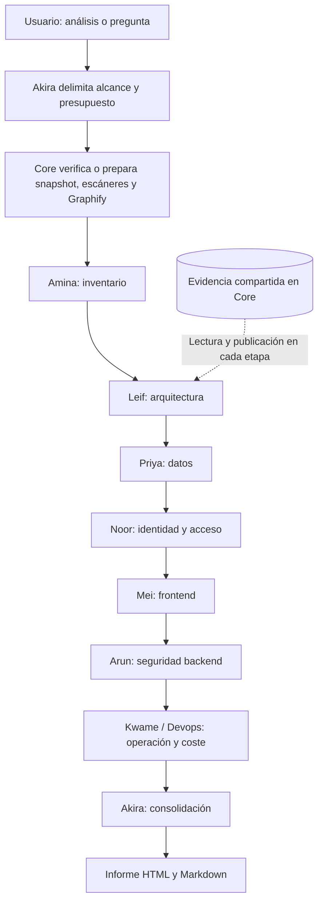
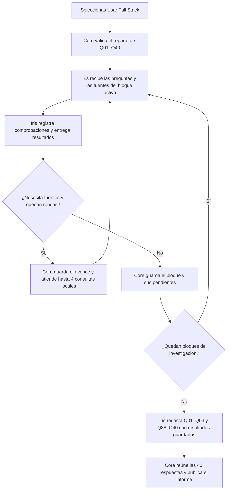

# Plan único de mejoras — Coordinación centralizada

Fecha: 30/10/2026. Estado: implementado con resultados y límites comprobados. La comparación inicial no demostró mejora; la prueba posterior de mapas reduce el consumo, pero no demuestra conservar la profundidad de Arquitectura y Devops. Chromium aplazado por indicación del usuario.

Este es el único plan de trabajo de Arktic Office. Sustituye el antiguo plan de fase 3, el prompt externo de agentes reutilizables y las alternativas anteriores de concurrencia. MVP y fases cerradas se conservan exclusivamente como histórico. El cierre publicado `76abf0f` es el punto de referencia para la implementación descrita aquí.

Siguiente etapa planificada el 10/11/2026: perfiles independientes, preparación inicial e Iris · Full Stack con selección desde la oficina (sección 11).

## 1. Objetivo y decisiones

Mejorar la cobertura y la eficiencia de la investigación, conservando el informe actual que ha funcionado. Las prioridades ejecutivas son vulnerabilidades, seguridad y riesgos de coste al desplegar en Azure. Inventario, arquitectura y datos aportan información que evita repetir investigaciones. Todas las preguntas siguen formando parte del análisis, incluidas las de operación y persistencia.

- Mantener las **40 preguntas Q01–Q40, sin añadir, suprimir ni reformular ninguna**. Cambiar su reparto por especialidad y compartir sus evidencias.
- Coordinación centralizada por Akira; ejecución **secuencial**, con una sola tarea de modelo activa cada vez, incluidas las consultas posteriores.
- Reutilizar hechos y preparación válidos; no enviar todos los informes a todos los modelos.
- Los especialistas pueden investigar problemas adicionales a sus preguntas. Todos los hallazgos confluyen en una única sección del informe.
- No añadir un segundo revisor automático, reparación automática de citas ni una batería de aplicaciones vulnerables. Decisión actualizada por el usuario el 31/10/2026: retirar también el filtro determinista de contenido y referencias. Se conserva únicamente la recepción técnica de los datos, los presupuestos, el acceso acotado a archivos y el escape HTML. Akira consolida; no juzga ni reescribe las respuestas de los especialistas.
- Mantener los tres contenedores, sin Redis, nuevos servicios, cambios de modelos ni ampliaciones de CI/CD en este alcance.
- Cada nuevo perfil tendrá persona, escritorio, estado y panel de consulta en el frontend.

## 2. Qué tomamos del estudio de Google

[Google Research: Towards a science of scaling agent systems](https://research.google/blog/towards-a-science-of-scaling-agent-systems-when-and-why-agent-systems-work/).

El estudio compara agentes únicos y equipos independientes, centralizados, descentralizados e híbridos. Sus resultados señalan que la descomposición y las dependencias del trabajo importan más que aumentar el número de agentes. La coordinación tiene un coste y puede perjudicar tareas con razonamiento secuencial muy conectado.

Nuestra decisión es una aplicación de esas observaciones: Akira distribuye encargos acotados y conserva una vista común; cada especialista sigue completo el recorrido que está investigando. Elegimos ejecución secuencial para aprovechar los resultados previos y controlar recursos. **Google no demuestra que nuestra secuencia vaya a gastar menos tokens**, ni prescribe esta plantilla o este número de especialistas. El ahorro se comprobará con métricas de nuestro sistema.

No se desarrollarán ahora ejecución paralela, conversación entre todos los agentes ni una arquitectura híbrida. Consultar evidencia publicada por otro especialista no implica iniciar una conversación con su modelo.

## 3. Perfiles, preguntas y orden de trabajo

| Orden | Persona y nombre visible | Perfil técnico propuesto | Responsabilidad | Preguntas principales |
| --- | --- | --- | --- | --- |
| Apertura y cierre | Akira · Coordinador | coordinator | Delimitar encargos, resolver dependencias y consolidar riesgos, protecciones y discrepancias | Q01–Q03, Q38–Q40 |
| 1 | Amina · Inventario | inventory | Lenguajes, versiones, tecnologías y servicios externos; publicar hechos reutilizables | Q04–Q06 |
| 2 | Leif · Arquitectura | architecture | Tipo de aplicación, componentes, entradas, conexiones y límites de confianza | Q07–Q09 |
| 3 | Priya · Datos | data | Almacenes, caché, conservación, copias y datos personales | Q10–Q14 |
| 4 | Noor · Seguridad | identity | Identidad, permisos, sesiones, contraseñas y limitación de intentos | Q23–Q27 |
| 5 | Mei · Seguridad frontend | frontend-security | Cookies, XSS, secretos del navegador y consentimiento | Q28–Q31 |
| 6 | Arun · Seguridad backend | backend-security | Entradas y operaciones del servidor, secretos, datos salientes y consumo abusivo; contrastar alertas de dependencias aplicables | Q32–Q37 |
| 7 | Kwame · Devops | devops | Construcción, Docker, CI/CD, conexiones, despliegue, exposición y riesgos de consumo/coste | Q15–Q22 |

Ocho perfiles habituales contando al coordinador. Arun se denomina **Seguridad backend** y Kwame mantiene **Devops**. No se incorpora un perfil Hacker ni un tester adicional. El nombre Hacker se reserva para un especialista con alcance propio de investigación de vías de ataque: acceso indebido a bases de datos, afectación a usuarios y otras posibles vulnerabilidades explotables. No es otro nombre para Seguridad backend ni implica que se hayan realizado ataques o pruebas activas. Zola no se activa como etapa de validación en este alcance.

El orden coloca inventario y arquitectura primero. Datos y permisos ayudan a los análisis posteriores; Devops puede aprovechar los recorridos y operaciones costosas encontrados por los demás. Una consulta posterior específica usa únicamente los perfiles necesarios y los resultados vigentes, sin repetir automáticamente toda la secuencia.

Akira asigna cada pregunta exactamente una vez como responsabilidad principal. Los demás pueden aportar evidencia, sin generar respuestas competidoras innecesarias. Q38–Q40 se aplican a cada problema: el autor entrega defensas, condiciones, impacto y pendientes; Akira consolida esas aportaciones. No constituyen otra pasada completa de modelos ni una certificación independiente.

Si una comprobación no aplica, se conserva su pregunta y una explicación respaldada. No se activa una llamada para rellenar un tema claramente ajeno a la revisión. La ausencia de backend en este repositorio no demuestra por sí sola ausencia de APIs externas ni de funciones de servidor dentro de un framework frontend.

## 4. Información centralizada y persistente

Se mantiene la topología actual:

| Contenedor | Contenido y responsabilidad |
| --- | --- |
| office | Interfaz y animación. Consulta Core por HTTP; no abre directamente la base ni el repositorio |
| audit-api | Core, Hermes, especialistas, planificación, búsquedas y escritura de la información compartida |
| preparator | Extracción de Graphify mediante el adaptador instalado |

Ubicación propuesta, aprovechando el montaje persistente existente `./reports` del host a `/reports` en Core:

```text
reports/
  .preparation-cache/             Preparación compatible reutilizable
  .knowledge/
    office.sqlite                Revisiones, hechos, referencias, tareas, estados y métricas
    artifacts/<revision-key>/    Resultados grandes referenciados desde SQLite
  <fecha>/<proyecto>/<run-id>/
    agents/<agent-id>/
      assignment.json            Preguntas, alcance y presupuesto del encargo
      notes.md                   Notas locales de investigación
      result.json                Respuestas, hallazgos y referencias
      summary.md                 Resumen consultable de esta aportación
    estado.json                  Exportación compatible para el historial actual
    celulas/                     Exportaciones compatibles de resultados
    informe.html
    informe.md
```

Core controla las transacciones y las exportaciones. Las notas no se convierten automáticamente en hechos confirmados. Los modelos consultan mediante herramientas delimitadas; no reciben SQL arbitrario ni permisos para sobrescribir el resultado de otro especialista.

La base contiene identidad del repositorio, commit, huella de captura, hechos con procedencia, referencias a archivos/líneas, versiones de herramientas y reglas, preguntas, estado, dependencias, hallazgos y métricas. Se separan observaciones, hipótesis, protecciones verificadas e incidencias técnicas. Decisión actualizada el 31/10/2026: no ocultar ni ofuscar el contenido de código, configuración o resultados de herramientas. Conservar los originales; el informe presenta el texto del especialista con autoría, sin segunda revisión automática.

Las capturas locales completas continúan en `artifacts/local-inputs`, montadas como `/local-inputs` de solo lectura. El código de trabajo puede extraerse temporalmente en Core. La recreación de un contenedor no borra los datos del montaje persistente; el montaje no equivale a una copia de seguridad.

### Reutilización y búsqueda

1. Consultar resultados deterministas, inventario y hechos disponibles para la revisión actual.
2. Usar Graphify y los mapas para localizar relaciones relevantes.
3. Buscar directamente en todo el texto disponible y leer código cuando sea necesario; la falta de parser no bloquea la lectura de un archivo de texto capturado.
4. Publicar hechos nuevos con referencias; una conclusión anterior orienta la búsqueda, sin sustituir la evidencia original.

Mejorar la búsqueda para consultar contenido aunque existan coincidencias en nombres de archivo, devolver localizaciones precisas y paginar por todas las coincidencias. Utilizar símbolos y relaciones cuando estén disponibles. Ampliar las reglas locales de seguridad según las tecnologías detectadas y conservar cobertura y límites por herramienta.

Mantener la caché de preparación independiente del modelo. Verificar identidad e integridad antes de reutilizar; cambios de captura, herramientas o reglas relevantes invalidan los derivados afectados. Auditar que se incluyan también los archivos de reglas JSON que se utilicen. La información externa de vulnerabilidades necesita una política de vigencia propia y renovación manual explícita.

Las conclusiones de modelos tienen una identidad separada: revisión, encargo, instrucciones y perfil efectivo. Al volver a comparar modelos se reutiliza la preparación, pero se generan nuevas respuestas. No se reutilizan como resultados de la nueva prueba las conclusiones que se pretende comparar.

## 5. Flujo secuencial y comunicación



Cada etapa lee y publica en la misma base; la flecha de evidencia ilustra esa relación, no una excepción exclusiva para Arquitectura. Las etapas no aplicables se resuelven sin llamada al modelo, conservando las preguntas y su justificación. Las respuestas visibles mantienen su orden temático, aunque el orden de ejecución sea distinto.

Las consultas pasan por Core y Akira. Primero se busca un hecho ya publicado; si falta, se crea una investigación acotada para el responsable. No se despierta al modelo de otro agente para devolver un dato que Core ya puede recuperar. Si la consulta necesita un especialista posterior, Core evita dependencias circulares y registra el pendiente; el investigador puede leer el código directamente dentro de su alcance.

Antes de cerrar una pregunta sensible, seguir el recorrido aplicable: entrada, identidad, permiso, operación y destino de los datos. Registrar qué se comprobó y qué defensa se encontró. No partir cada paso de ese mismo razonamiento entre varios agentes.

### Fallos, esperas y presupuesto

| Situación | Comportamiento |
| --- | --- |
| Error de captura o falta de integridad | Detener la ejecución antes de consumir modelos |
| Herramienta de mapa sin soporte para un lenguaje | Registrar el límite y permitir búsqueda/lectura directa; no afirmar ausencia de funcionalidad |
| Especialista falla | Guardar sus aportaciones válidas y bloquear únicamente tareas que necesiten resultados ausentes; continuar las independientes |
| Evidencia directa permite continuar | El siguiente especialista investiga su alcance, sin inventar lo que falló |
| Credenciales del proveedor, acceso global o presupuesto agotados | Detener nuevas llamadas y mostrar el motivo |
| Referencia no localizable | Conservar íntegros el texto, el estado y la referencia indicados por el especialista; localizar lo posible para presentación, sin descartar la respuesta ni repararla con modelos |
| Reinicio o conexión perdida | Registrar interrupción/estado desconocido; no repetir automáticamente una llamada cuyo resultado remoto se desconoce |

Establecer presupuesto total por revisión y límites de tiempo, llamadas y contexto por tarea. El reparto no multiplica automáticamente por siete los presupuestos actuales. Registrar tokens comunicados por el proveedor, contexto reenviado y duración real; mostrar «No disponible» si faltan métricas. Los límites de proveedor que no sean duros se documentan; Core puede impedir nuevas llamadas sin prometer interrumpir una generación remota ya iniciada al token exacto.

La falta de un resultado se distingue de «no aplica». La parada identifica tarea, motivo, aportaciones conservadas y condición necesaria para continuar. No hay bucles indefinidos ni reintentos automáticos repetidos.

## 6. Panel compacto y oficina

- Catálogo único de perfiles para backend y frontend. Ocho personas y ocho escritorios estables para los perfiles habituales.
- Tarjetas en cuadrícula adaptable al ancho: primero nombre de persona, debajo rol; actividad breve, modelo, esfuerzo, duración y tokens disponibles. Mostrar resultado resumido y un error breve visible cuando exista.
- Indicador de carga solo durante ejecución real. Diferenciar en cola, investigando, esperando, finalizado y error; cobertura y ejecución son conceptos separados.
- Al pulsar tarjeta o avatar se abren detalles y la consulta. Retirar de la tarjeta las instrucciones completas del rol y los avisos genéricos largos; no ocultar errores relevantes.
- Las consultas durante una revisión se encolan y no crean una segunda llamada simultánea. Mostrar «En cola» hasta que comiencen.

| Estado real | Comportamiento del personaje |
| --- | --- |
| Ejecutando una investigación o respuesta | Va a su escritorio y se sienta |
| Síntesis final del informe en curso | Participa en la reunión visual: sentado en la sala o en su escritorio si no hay plaza |
| En cola o esperando una dependencia | Disponible de pie o descansando, sin aparentar ejecución |
| Finalizado | Se levanta y conserva su resultado consultable; durante la síntesis final permanece en la reunión hasta que el informe esté listo |
| Bloqueado o error | Deja de aparentar trabajo y muestra el motivo |
| Nueva consulta comienza a ejecutarse | Regresa y se sienta hasta terminar |

Akira se sienta al repartir o responder y participa sentado en la reunión de síntesis. Mientras no tenga tarea propia activa permanece disponible de pie, aunque otros estén trabajando. La animación no inicia llamadas al modelo.

### Reunión final de síntesis

Al comenzar la síntesis o resumen final, Core publica un estado específico de reunión para la revisión activa. El frontend representa una sesión de videoconferencia tipo Teams, vinculada a ese estado real:

1. Reservar a Akira una plaza en la sala y asignar las demás plazas libres a los especialistas que participaron en esta revisión. La capacidad la determinan los asientos accesibles del mapa; no apilar personajes ni inventar plazas.
2. Los participantes sin plaza permanecen o regresan a sus propios escritorios y se sientan, como asistentes remotos. Los perfiles no convocados para esa revisión no se incorporan artificialmente.
3. Añadir una televisión en la sala. Se enciende durante la reunión y muestra una vista de informe compartido en preparación, participantes e iconos de micrófono silenciado. Si ya hay contenido guardado de esta revisión, se puede representar; no mostrar conclusiones aún no generadas ni datos de otra revisión.
4. Representar la puesta en común con indicadores visuales discretos de revisión o atención al informe. No inventar diálogo, atribuir afirmaciones a los agentes ni reproducir voces. La sesión permanece en silencio, sin acceso al micrófono o la cámara del usuario ni conexión a Microsoft Teams.
5. Los paneles distinguen «En reunión final» de «Ejecutando análisis». Solo las llamadas reales incrementan actividad de modelo y consumo; sentarse como participante no consume tokens ni activa de nuevo a los especialistas.
6. Cuando la generación y el guardado del informe terminan y este queda disponible para abrir y descargar, apagar la televisión, liberar las plazas y levantar a todos los participantes, incluidos los de los escritorios. La disponibilidad del informe no espera a que termine una animación ni a que todos alcancen su asiento.
7. Si la síntesis se interrumpe, se cancela o falla, terminar la reunión y mostrar la incidencia. Un informe parcial válido también finaliza la reunión al quedar guardado, conservando su estado y limitaciones. Una consulta posterior normal sienta únicamente a quien la atienda; no convoca automáticamente a todo el equipo.

Aplicar el estado a la ejecución activa, incluso si el usuario está leyendo un informe histórico. Al reconectar, recuperar la fase real desde Core. La reunión debe tener prioridad sobre el paseo de ocio y disponer de asignación de asientos estable para evitar cambios continuos de plaza.

Corregir asientos conjuntamente en mapa, simulación y render: destino accesible, anclaje del cuerpo, orientación y profundidad de dibujo. En sofás, sentarse delante del respaldo y mirando al frente; en escritorios, hacia el monitor. Reservar plazas y evitar que un asiento ocupado sea la alternativa automática.

Reducir aproximadamente a un tercio los desplazamientos de ocio. Partir de pausas de 12–30 segundos frente a las actuales 4–10 y medir la frecuencia efectiva de recorridos. Mantener la velocidad de caminar para no alargar el tiempo de paseo y permitir que un encargo interrumpa el ocio.

## 7. Informe: conservar preguntas y unificar hallazgos

- Mantener el diseño actual, la visualización directa y ambas descargas.
- Resumen ejecutivo comprensible: qué es la aplicación, riesgos prioritarios y protecciones importantes comprobadas. Máximo diez riesgos en el resumen, sin rellenar un cupo.
- Una sección de vulnerabilidades y riesgos recibe los hallazgos de preguntas, escáneres contrastados e investigación adicional. Conservar autoría y evidencia, eliminar duplicados y señalar discrepancias. Los riesgos de coste se distinguen de las vulnerabilidades.
- Conservar las 40 preguntas en el detalle, incluida la explicación de las no aplicables y los puntos verdaderamente pendientes. No inferir que algo está bien únicamente por ausencia de alertas.
- Incluir hallazgos adicionales sin inventar nuevos identificadores de pregunta ni reformular las existentes.
- Conservar los anexos deterministas explicados en lenguaje natural, sin código ni JSON públicos; originales internos accesibles para investigación.
- Mantener fuera del informe la sección de recomendaciones y los planes de remediación. Q02 conserva su pregunta sobre prioridades antes/después de desplegar.
- Redacción ejecutiva y comprensible, sin coletillas de IA. Identificadores acompañados de nombre y explicación; no prefijos mecánicos como «Parcial. No…».
- Los costes monetarios de Azure necesitan parámetros y supuestos verificables; el código puede sustentar riesgos de gasto sin permitir una factura mensual exacta.

## 8. Bloques de implementación

| Bloque | Trabajo | Comprobación para cerrar |
| --- | --- | --- |
| M1. Contratos y referencia | Fijar las 40 preguntas y su reparto; definir hechos, referencias, tareas y actividad; revisar los dos fallos legados documentados sin cambiar expectativas a ciegas | Ninguna pregunta perdida o cambiada; compatibilidad histórica definida |
| M2. Búsqueda y herramientas | Corregir búsqueda por contenido, paginación y localización; ampliar reglas; revisar invalidación y vigencia de caché | Lectura directa funciona aunque Graphify no tenga parser; preparación compatible reutilizable |
| M3. Información común | Añadir SQLite, referencias y espacios por agente; consultas selectivas y exportaciones actuales | Hechos vinculados a revisión; persisten tras recrear Core; historial anterior sigue abriendo |
| M4. Especialistas secuenciales | Integrar perfiles, preguntas, publicación por etapa, dependencias, presupuestos y paradas | Cada tarea usa aportaciones anteriores pertinentes; fallos no generan llamadas sin utilidad |
| M5. Interfaz y oficina | Catálogo dinámico, personas/escritorios, cuadrícula, detalle, estados reales, asientos, paseos y reunión final con televisión | Participantes repartidos entre sala y escritorios, pantalla en silencio y cierre al quedar disponible el informe; perfiles visibles y consultables |
| M6. Comparación y cierre | Validar informe y descargas, matriz de preguntas, consumo, tiempo y cobertura sobre alcance equivalente | Ahorro o coste adicional explicado; sin pérdida silenciosa de cobertura |

M1–M4 preceden a activar los nuevos perfiles en producción. La corrección de asientos y ocio puede prepararse de forma independiente dentro de M5. No desplegar una oficina que anuncie agentes todavía no conectados al backend.

### Estado comprobado de la implementación · 30/10/2026

| Bloque | Estado | Resultado comprobado |
| --- | --- | --- |
| M1 | Implementado | Catálogo Q01–Q40 comparado por ID y texto con la copia exacta de `76abf0f`; un responsable por pregunta. La copia de referencia conserva la huella indicada al final del plan. Se investigaron las dos expectativas legadas: huellas de prompts/formatos anteriores y diferencias de presentación de cobertura entre HTML y Markdown; no se regeneraron referencias automáticamente. |
| M2 | Implementado | Búsqueda simultánea por nombres y contenido, localizaciones y páginas de coincidencias; prioridad de definiciones del grafo sin perder las demás coincidencias. Lectura de texto sin parser. Catorce reglas Semgrep validadas; el JSON de reglas participa en la identidad de caché. Vigencia OSV de 24 horas por defecto y renovación manual existente. |
| M3 | Verificado | SQLite transaccional en `.knowledge/office.sqlite`, identidad por revisión, procedencia, hechos, tareas, estados y eventos; artefactos y espacios por agente. Tras recrear Core se conservan exactamente 8 tareas, 98 hechos y las huellas de los tres informes de la prueba real. Integridad SQLite correcta. Historial anterior y descargas conservados. |
| M4 | Implementado | Siete especialistas en el orden fijado y Akira. Contexto anterior seleccionado por preguntas pertinentes; límites globales y por tarea, parada global de proveedor, bloqueo de dependencias declaradas y conservación de aportaciones. Consultas en cola y una sola actividad de modelo; recuperación por ID de pregunta guardada sin llamada. |
| M5 | Implementado y probado en simulación; revisión visual aplazada | Catálogo servido por Core; ocho personas y escritorios, tarjetas compactas, detalle y consulta, estado de reunión, televisión silenciosa, cuatro plazas en sala y resto en escritorios. Simulación de navegación, plazas exclusivas, estabilidad y liberación correcta. Pausas 12–30 segundos: 178 recorridos frente a 456 en 600 segundos sobre el mismo mapa y con velocidad idéntica (61 % menos). Parche del sofá conservado. Chromium queda expresamente pendiente por indicación del usuario. |
| M6 | Comparación y descargas verificadas; beneficio no demostrado | Mismo commit, inventario y textos Q01–Q40, Sol/medium. La prueba pasa de 19 a 31 llamadas y de 709.084 a 1.189.320 tokens (+67,7 %); preguntas respondidas: 12 → 4, parciales: 23 → 24, no comprobadas: 5 → 12. No se oculta la regresión ni se repite automáticamente el análisis. HTML/Markdown anterior y nuevo coinciden byte a byte con los guardados; 40 anclas de pregunta en el nuevo HTML. Caché compatible comprobada sin repetir Graphify, escáneres ni modelos en la segunda lectura. |

Los resultados y las limitaciones de la entrega se recogen en `docs/RESULTADOS_COORDINACION_2026-10-30.md`. Este apartado registra verificaciones; no cambia las decisiones ni añade otro plan.

Pruebas dirigidas sobre contratos, recuperación, fallos, API y animación; revisión visual real del mapa. No relanzar un proyecto completo por cada ajuste de presentación. Comparar el sistema con la referencia actual usando el mismo repositorio, alcance y perfil de modelo; tokens más bajos con preguntas sin investigar no cuentan como mejora. La comparación no incorpora la batería de aplicaciones vulnerables descartada.

## 9. Límites y criterios de aceptación

- El código analizado sigue siendo de solo lectura y no se ejecuta ni se instalan sus dependencias.
- Los modelos reciben herramientas gestionadas por Core, sin consola general ni escritura en el repositorio original.
- Un prompt no impone aislamiento de red. El Core actual no tiene una lista de destinos salientes que lo limite exclusivamente a proveedores de modelos; este plan no promete que ya exista ni añade infraestructura de red como trabajo separado.
- Cero diferencias en IDs o textos de Q01–Q40; un responsable principal por pregunta; las no aplicables permanecen en el resultado.
- Sin mezcla de hechos de commits distintos, sin doble contabilización del presupuesto y sin estados de ejecución ficticios.
- Fallos y bloqueos visibles; resultados válidos conservados; cada parada tiene un motivo verificable.
- Informes históricos y descargas siguen disponibles. No se reescriben informes antiguos para simular análisis nuevos.
- El modelo y sus métricas reales aparecen por ejecución. Cada perfil añadido tiene persona, escritorio y consulta.
- Durante la síntesis final, la sala usa solo sus plazas libres y el resto participa desde su escritorio. Televisión encendida e indicadores de silencio; no se generan llamadas adicionales por animación. Al guardar el informe disponible para ver y descargar, o ante una interrupción, todos se levantan y la pantalla se apaga.
- Se registran duración total, llamadas, tokens informados, contexto repetido y cobertura por pregunta. No se garantiza ahorro antes de medir.

## 10. Matriz completa de las preguntas conservadas

Los textos siguientes se conservan del catálogo de referencia, incluidos sus matices. El catálogo efectivo `backend/src/arktic_office/resources/profiles/questions.json` ya aplica este reparto; `questions-reference.json` conserva exactamente el archivo de `76abf0f`. La ejecución nueva se identifica como `central-coordination-v1`; los informes históricos no se reescriben.

| ID | Responsable principal propuesto | Pregunta conservada |
| --- | --- | --- |
| Q01 | Akira — Coordinación | ¿Cuáles son las conclusiones y los problemas más importantes de los análisis solicitados? |
| Q02 | Akira — Coordinación | ¿Qué habría que resolver antes de desplegar y qué puede dejarse para después? |
| Q03 | Akira — Coordinación | ¿Qué puntos quedan sin comprobar o tienen conclusiones contradictorias? |
| Q04 | Amina — Inventario | ¿Cuál es el lenguaje principal de la aplicación y qué otros lenguajes utiliza? |
| Q05 | Amina — Inventario | ¿Qué tecnologías y frameworks principales utiliza, qué versiones tienen y para qué sirve cada uno? |
| Q06 | Amina — Inventario | ¿A qué servicios externos se conecta y para qué utiliza cada uno? Incluye servicios de inteligencia artificial y gateways de acceso a modelos. |
| Q07 | Leif — Arquitectura | ¿Qué contiene este repositorio: frontend, backend, ambos u otro tipo de aplicación? ¿Para qué sirve cada parte? |
| Q08 | Leif — Arquitectura | ¿Funciona como una sola aplicación o está dividida en servicios? ¿Cómo se conectan sus partes principales? |
| Q09 | Leif — Arquitectura | ¿Cómo organiza el código y sus responsabilidades? ¿Sigue alguna arquitectura o mezcla varias? Explica brevemente con ejemplos. |
| Q10 | Priya — Datos | ¿Qué bases de datos, archivos u otros almacenes utiliza? ¿Dónde están, qué información guardan y cuáles hay que conservar al migrar? |
| Q11 | Priya — Datos | ¿Utiliza caché? ¿Qué guarda, durante cuánto tiempo y cómo protege los datos sensibles? Contrasta la protección con Seguridad. |
| Q12 | Priya — Datos | ¿Qué datos se conservan al reiniciar la aplicación y cuáles se pierden? |
| Q13 | Priya — Datos | ¿Existe un sistema de copias de seguridad? ¿Qué guarda y cómo se recuperan los datos? |
| Q14 | Priya — Datos | ¿Qué datos personales guarda? ¿Permite consultarlos, corregirlos y eliminarlos? ¿Define cuánto tiempo los conserva? |
| Q15 | Kwame — Devops | ¿Cómo se construye y se arranca la aplicación? Identifica los comandos y scripts necesarios. |
| Q16 | Kwame — Devops | ¿Qué necesita para arrancar, como variables de configuración, bases de datos u otros servicios? |
| Q17 | Kwame — Devops | ¿Está preparada para ejecutarse con Docker o Docker Compose? ¿Qué partes se ejecutan en contenedores? |
| Q18 | Kwame — Devops | ¿Tiene procesos automáticos de integración y despliegue (CI/CD)? ¿Qué construyen, comprueban o despliegan? |
| Q19 | Kwame — Devops | ¿Los datos se conservan si se elimina o se vuelve a crear el contenedor? ¿Qué hay que configurar para conservarlos? |
| Q20 | Kwame — Devops | ¿Qué conexiones externas hay que configurar para que funcione en nuestro entorno? |
| Q21 | Kwame — Devops | ¿Está preparada para funcionar en local, en una red interna o en Internet? ¿Hay información sobre dónde está desplegada y en qué país? |
| Q22 | Kwame — Devops | ¿Qué partes pueden consumir más memoria, CPU o disco? ¿Hay límites configurados y qué habría que medir para conocer el consumo real? |
| Q23 | Noor — Seguridad: identidad y acceso | ¿Tiene un sistema de autenticación? Si existe, sigue el recorrido de una petición y explica cómo comprueba la identidad y si algún acceso sensible queda sin proteger. |
| Q24 | Noor — Seguridad: identidad y acceso | ¿Comprueba qué puede ver y hacer cada usuario? ¿Podría alguien acceder a datos de otros usuarios o realizar acciones sin permiso? |
| Q25 | Noor — Seguridad: identidad y acceso | ¿Cómo mantiene la sesión del usuario? ¿Cuándo caduca y cómo se invalida al cerrar sesión? |
| Q26 | Noor — Seguridad: identidad y acceso | ¿Dónde y cómo guarda las contraseñas de los usuarios y los tokens de sesión? ¿Están protegidos? |
| Q27 | Noor — Seguridad: identidad y acceso | ¿Limita los intentos de inicio de sesión para evitar que alguien pruebe muchas contraseñas? |
| Q28 | Mei — Seguridad frontend | ¿El frontend guarda o lee información sensible en las cookies? ¿La expone o la comparte con terceros? |
| Q29 | Mei — Seguridad frontend | ¿El frontend muestra datos que podrían ejecutar código malicioso en el navegador (XSS)? |
| Q30 | Mei — Seguridad frontend | ¿Expone claves, contraseñas o API keys privadas en el código o los archivos que recibe el navegador? |
| Q31 | Mei — Seguridad frontend | ¿Utiliza cookies que necesitan consentimiento? Si las utiliza, ¿permite aceptarlas, rechazarlas y cambiar la elección? ¿Las bloquea hasta obtener permiso? |
| Q32 | Arun — Seguridad backend | ¿El servidor genera páginas o contenido que podrían ejecutar código malicioso en el navegador (XSS)? |
| Q33 | Arun — Seguridad backend | ¿Guarda información sensible en las cookies? ¿Cómo las protege para evitar su exposición? |
| Q34 | Arun — Seguridad backend | ¿Alguien podría manipular los datos que envía para alterar las consultas a la base de datos (inyección SQL)? |
| Q35 | Arun — Seguridad backend | ¿Hay operaciones que puedan quedarse bloqueadas, repetirse sin límite o agotar los recursos? Incluye lo que ocurre si un servicio externo falla o tarda en responder. ¿Qué controles existen? |
| Q36 | Arun — Seguridad backend | ¿Dónde guarda las claves y contraseñas que utiliza para conectarse a bases de datos o servicios externos? ¿Hay secretos escritos en el código o incluidos en archivos del repositorio, como los .env? |
| Q37 | Arun — Seguridad backend | ¿Qué información envía a servicios externos? ¿Incluye datos sensibles y cómo los protege? Incluye la protección de datos sensibles en caché. |
| Q38 | Akira — Coordinación | Para cada problema señalado: ¿está sustentado por el código o hay alguna protección que lo evita? |
| Q39 | Akira — Coordinación | Para cada problema señalado: ¿qué condiciones necesita para ocurrir y qué impacto tendría? |
| Q40 | Akira — Coordinación | Para cada problema señalado: ¿qué se ha comprobado y qué falta para confirmarlo o descartarlo? |

Huella SHA-256 del catálogo de referencia: `e1ae857f1b66b64a615760d42372c14e1d8e4d51d8ff3728793fda14f47bad05`.


## Actualización de ejecución — 31/10/2026: originales sin filtro

Decisión expresa del usuario posterior al diagnóstico: eliminar la ocultación y el validador de respuestas. Esta actualización sustituye cualquier instrucción anterior de este documento sobre ocultar contenido o rechazar una conclusión por sus citas. No cambia Q01–Q40, modelos, presupuestos ni ejecución secuencial.

Implementado: entrega de fuentes sin transformación, Gitleaks sin `--redact`, resultados originales conservados, recepción de respuestas sin evaluación de citas/longitud/fundamento y sin descenso automático de su estado. Los originales completos se guardan siempre, incluso si el JSON no puede recibirse. Las referencias originales acompañan a las localizadas. HTML y Markdown incorporan un anexo con las aportaciones originales, separado de la síntesis de Akira. La caché identifica la nueva política para no reutilizar fuentes ocultadas. El acceso a rutas, integridad, límites, cola secuencial y escape de HTML siguen siendo controles técnicos.

Verificación: reproducción offline de las siete respuestas archivadas, sin proveedores: las 34 respuestas especializadas conservan exactamente texto y estado; 8 respondidas, 25 parciales y 1 no comprobada. Los HTML/Markdown de esta reproducción conservan el anexo y las 40 anclas. Se generan en `artifacts/central-coordination`, sin reescribir el análisis histórico. Este ensayo no prueba una mejora nueva de investigación ni restaura contenido ya ocultado en aquella captura. La comparación histórica M6 permanece registrada tal como ocurrió.

Suite final de la nueva política: 196 pruebas, 195 correctas y una omisión preexistente. El diagnóstico del 31/10 recoge el detalle de Arun (5 llamadas frente a 6, +0,31 % de tokens) y distingue ese coste individual del de los tres especialistas de seguridad.

Servicio actualizado y saludable. Comprobación posterior: ocho perfiles disponibles, sin revisiones activas ni reunión abierta y sin incremento de las 31 llamadas históricas. Las cuatro descargas HTML/Markdown de las dos revisiones coinciden con los archivos guardados. Los 103 archivos históricos comprobados permanecen idénticos y SQLite devuelve `integrity_check=ok`. Evidencias: `api-original-policy.json`, `download-original-policy.json`, `original-policy-persistence.json` y `backend-original-policy-release.log`, en `artifacts/central-coordination`. No se hicieron commits ni publicaciones.


## Actualización acordada — mapas y consultas locales (31/10/2026)

Se sustituye el envío anticipado de respuestas completas por un mapa determinista de preguntas publicadas en esta revisión: ID, pregunta original, autor y estado, sin respuestas ni citas. Cada especialista puede solicitar hasta cuatro IDs mediante `{"questions":["Q25","Q11"]}` dentro del mecanismo `queries` existente. Core lee SQLite, entrega los textos y estados originales y agrupa las ubicaciones de fuentes contiguas; las citas completas permanecen guardadas. Consultar información publicada no despierta a otro modelo ni habilita SQL arbitrario. Una pregunta aún no publicada devuelve su indisponibilidad; si una consulta agrupada contiene otras disponibles, esas respuestas se conservan.

Los escáneres siguen el mismo principio: mapa inicial con nombre, finalidad, estado y cantidades, sin detecciones ni salidas completas. `{"tool":"D04","index":true}` descubre ubicaciones y tipos; `tool`, `query`, `paths`, `offset` y `limit` permiten solicitar resultados pertinentes y paginados de Gitleaks, OSV y Semgrep. Se retira el envío duplicado de detecciones en el contexto común y en el contrato de salida. Los originales y anexos deterministas se conservan íntegros. La consulta de inventario y cobertura Graphify sigue disponible como D01/D05; las búsquedas de símbolos, relaciones, texto y lecturas directas de código conservan su funcionamiento.

Se usan las mismas rondas, hasta cuatro consultas locales por ronda y los mismos límites/modelos/presupuestos. Consultar mapas o SQLite no crea llamadas de revisión o resumen. El modelo puede consumir una ronda para pedir datos, por lo que no se promete ahorro total ni mejora de cobertura sin una comparación real. Las métricas de cada llamada incorporan tamaños del mapa de preguntas, mapa de herramientas, código retenido e historial solicitado.

Medición offline sobre la revisión archivada de Arun: las siete respuestas antes precargadas ocupaban 67.153 bytes por llamada; el nuevo mapa permite descubrir veinte respuestas previas con 3.850 bytes (-94,27 % frente a aquel bloque). La reconstrucción de la primera petición ocupa 30.449 bytes frente a los 114.381 registrados (-73,38 %). Es una comparación de bytes reconstruidos, no una medición de tokens nuevos. Cero llamadas a proveedores y ningún informe histórico reescrito. Evidencia en `artifacts/central-coordination/lookup-maps-measurement.json`.

Cierre de mapas comprobado: backend actualizado y saludable; 202 pruebas (201 correctas y una omisión previa), API con ocho perfiles y sin tareas activas, cuatro descargas HTML/Markdown idénticas a las guardadas, 103 archivos históricos intactos e integridad SQLite correcta. Sin llamadas reales a modelos, cambios de modelos/presupuestos, commits ni publicaciones. Chromium continúa aplazado. Evidencias finales: `backend-lookup-maps-verified.log`, `recreate-lookup-maps.log`, `lookup-maps-verification.json` y `download-lookup-maps.json`, en `artifacts/central-coordination`.


### Prueba real de mapas completada · 31/10/2026

Ejecución `813716cc-477b-4a4b-9795-a231973a4b9f`, mismo commit/inventario/Q01–Q40/Sol-medium y límites globales. Resultado: 30 llamadas, 717.849 tokens (-39,64 % frente al centralizado anterior), 874,675 segundos (-16,21 %) y 2.493.232 bytes de contexto (-40,83 %). Frente al sistema original de tres especialistas, el consumo queda +1,24 %. Se reutilizó la preparación compatible y se preservaron sus originales; no se ejecutó el proyecto objetivo.

M6 queda comprobado con resultado mixto: ahorro de contexto y tokens, sin errores técnicos, pero no se acredita mantener la profundidad de lectura. Publicado: 3 respondidas, 36 parciales y 1 no comprobada. Al comparar originales de las mismas 34 preguntas especializadas, 8 → 3 respondidas y 25 → 30 parciales: cambios en Q07–Q09 y Q15–Q16, sin intervención de un validador. Las 15 preguntas de Seguridad conservan sus estados originales con un 45,30 % menos de tokens en conjunto. Se leyeron 84 archivos frente a 100 y se realizaron 64 consultas de código frente a 79. La lectura pendiente de Arquitectura/Devops sigue siendo un límite real; no se relanza automáticamente la prueba.

Verificado: 34 respuestas originales intactas, 40 preguntas y anclas, seis descargas correctas, 103 archivos históricos sin cambios, ocho tareas y 105 hechos en SQLite con integridad correcta, reunión cerrada y presupuesto respetado. Chromium sigue aplazado. El resultado detallado y los límites de comparación se registran en `docs/RESULTADOS_MAPAS_2026-10-31.md`; es un cierre de resultados, no otro plan.


## Cierre estable y propuestas pendientes — 31/10/2026

Por instrucción expresa del usuario se guarda este punto estable mediante commit y push de la rama actual antes de hacer más cambios. No se aplica la unificación de perfiles comentada: permanecen siete especialistas y Akira, con Arquitectura y Datos separados. Estabilidad funcional no significa cobertura semántica completa. Se conservan los resultados favorables y desfavorables de las tres configuraciones en `docs/evidence/agent-comparison-2026-10-31/` y el cierre en `docs/CIERRE_COORDINACION_2026-10-31.md`.

Las siguientes propuestas quedan documentadas, **sin implementar ni activar**. Este apartado pertenece al único plan vigente; no es una autorización para nuevas ejecuciones de modelos.

| Propuesta | Motivo observado | Qué habría que comprobar antes de aceptarla |
| --- | --- | --- |
| Comparar tres especialistas con los mapas actuales y sin filtro de respuestas | La versión original tuvo consumo similar al actual y menos llamadas; las herramientas y el tratamiento de respuestas difieren | Misma captura, modelos y preguntas; presupuesto explícito; separar beneficio de las herramientas y del reparto entre agentes |
| Unificar Arquitectura y Datos en un responsable de Q07–Q14 | Son recorridos conectados: aplicación, servicios, almacenes, caché, conservación y datos personales; la separación puede fragmentar la visión | Mantener exactamente los ocho IDs/textos; un personaje, escritorio, panel y consulta funcional; compatibilidad de historiales; presupuesto dentro del techo vigente, sin aumentar modelo ni gasto global por inercia |
| Recuperar la lectura pendiente de Arquitectura y Devops | Q07–Q09 y Q15–Q16 quedaron menos concluyentes; Arquitectura cerró con una ronda disponible | Web pública, cliente/contexto tRPC, enrutador y módulos; tareas de Turborepo, paquete web, Dockerfile de migraciones e inyección de variables. Priorizar fuentes necesarias, sin consumir rondas por obligación ni añadir revisor |
| Afinar la selección y agrupación de consultas locales | SQL y escáneres ahorran contexto, pero ocuparon consultas antes usadas para código | Evitar recuperaciones redundantes y comprobar la lectura de las áreas relevantes, conservando los límites de rondas, consultas y contexto; no volver a precargar informes completos |
| Aclarar el significado de respondida/parcial en análisis estático | Una respuesta de configuración puede ser útil sin ejecutar producción; los agentes usan criterios de cierre distintos | Instrucciones claras, sin cambiar preguntas, sin reclasificar resultados guardados y sin un validador que reescriba al especialista; evaluar contenido y límites de lectura además de contar etiquetas |
| Completar Chromium cuando el usuario lo retome | Comprobación visual expresamente aplazada | Oficina, asientos, reunión/TV, paneles y descargas; la animación no debe generar llamadas a modelos |

Se mantienen las decisiones de ejecución secuencial, Core/SQLite/archivos, mapas consultables, respuestas originales, ausencia de ocultación y de un segundo validador, modelos configurados y preservación de Q01–Q40. No se ejecuta ni se instalan dependencias del repositorio analizado, ni se realizan ataques activos. Cualquier ensayo futuro requiere presupuesto definido y conserva sus resultados como una ejecución nueva.

## 11. Perfiles independientes y revisión Full Stack · 10/11/2026

Estado **fase 1 ejecutada y verificada en una corrida completa**. Los siete especialistas están separados y la selección inicial se probó de extremo a extremo. **Iris · Full Stack** y la elección en la oficina forman la fase 2. El equipo es la opción predeterminada y el usuario elige el modo de cada revisión.

### Fase 1. Perfiles independientes y preparación inicial

| Paso | Entrega | Aceptación |
| --- | --- | --- |
| 1 | Dar a cada especialista una carpeta en `resources/profiles/agents/<id>/` con `agent.json` (identidad, responsabilidad, IDs de preguntas, instrucciones y dependencias explícitas) e `initial-sources.json` (patrones y prioridades). Migrar primero a Kwame y retirar su entrada duplicada del perfil conjunto. El catálogo canónico conserva el texto de Q01–Q40 y el registro de perfiles activos conserva el orden. | Core valida IDs y preguntas, y conserva la carga de los perfiles aún pendientes de migrar. En la prueba de retirada, las preguntas huérfanas conservan su ID y se muestran como no comprobadas con motivo «sin responsable». Se comprueban altas, bajas, dependencias e informes previos. |
| 2 | Incorporar un único selector local de fuentes en Core. Antes de la primera llamada lee la lista del perfil y busca en el inventario del snapshot. Resuelve coincidencias por pila tecnológica, deduplica rutas, prioriza los fragmentos y aplica un límite de archivos y bytes. El agente recibe los fragmentos seleccionados y las rutas útiles que quedaron pendientes. | Preparación con cero llamadas al modelo. Selección reproducible, con coincidencias ausentes o truncadas registradas. Los fragmentos cuentan en el presupuesto de contexto y las rondas posteriores reutilizan la lectura. Las consultas directas y Graphify siguen disponibles para la investigación del agente. |
| 3 | Probar la nueva preparación solo con Kwame, conservando la instrucción que ya le pide seguir scripts, migraciones y validaciones de arranque. Su lista empieza por README de raíz y de módulos relevantes, manifiestos y configuración de tareas para JavaScript, Java y Python, scripts, contenedores, CI/CD, ejemplos de variables y código de arranque. | Misma captura de Web Corporativa 2.0 (`4ae82b4`), GPT-6.1 Sol / medio y hasta cuatro llamadas. Comparar con los 107.470 tokens de la última prueba aislada y revisar evidencia nueva en Q15 y Q16, profundidad, tiempo y archivos leídos. Se acepta más tiempo con consumo igual o menor y mejor respaldo. |
| 4 | Migrar el resto por decisión del usuario, con límites iniciales más pequeños y una sola corrida completa al final. Amina prioriza dependencias y versiones; Leif, puntos de entrada, módulos y conexiones; Priya, esquemas, almacenamiento y migraciones; Noor, identidad y permisos; Mei, rutas de navegador y controles frontend; Arun, entradas, validación y operaciones sensibles del backend. | Una lista por perfil. Las asignaciones, el orden, las dependencias y el comportamiento del equipo se comprueban con la suite local antes de activar el segundo modo. |

Cada perfil puede pedir el README de la raíz y de los módulos que le interesen. Core entrega los apartados relevantes dentro del mismo límite. El especialista contrasta las afirmaciones con código y configuración y señala las discrepancias. Para variables sensibles se buscan ejemplos y puntos de uso o validación.

#### Resultado del piloto de Kwame · 10/11/2026

El anexo aprobado se guardó por separado en `8e80ce7`. Se movió Kwame a su carpeta propia y se integró el selector común. En la comprobación previa, Core entregó 11 archivos y 10.489 bytes de fuentes con cero llamadas al modelo. Incluyó `turbo.json`, los manifiestos de las tres aplicaciones, el README y el tramo del Dockerfile con el comando de migración. Suite de backend en Linux con 203 pruebas correctas y una omitida. El paquete instalable contiene la definición y la lista de Kwame.

Se ejecutó un solo piloto real con la captura `4ae82b4`, GPT-6.1 Sol / medio y las mismas cuatro llamadas. El consumo pasó de 107.470 a 137.368 tokens (+27,82 %), el tiempo de 123,877 a 169,423 segundos y los archivos leídos de 22 a 26. El contexto enviado pasó de 374.939 a 458.664 bytes.

- Q15 pasó de parcial a respondida. La respuesta cita la configuración de Turborepo y el script de despliegue que espera las migraciones antes de actualizar las aplicaciones. Quedó pendiente leer la implementación de la carga inicial y del alta del administrador.
- Q16 siguió parcial. La respuesta contrastó el código de correo y OneDrive para explicar que sus variables se comprueban al usar esas funciones. Quedaron pendientes partes de la inyección de secretos y de la configuración requerida por aplicación.
- Q18 pasó a respondida y Q19 a parcial. El total del perfil quedó en tres respondidas y cinco parciales.

El piloto ganó evidencia y superó el umbral de consumo. El usuario autorizó migrar los demás perfiles con listas iniciales más pequeñas y reservar la ejecución real del equipo para el final. Los resultados detallados se guardaron localmente en la caché de la prueba, fuera del repositorio de Arktic Office.


#### Separación de los siete perfiles · 10/11/2026

Cada especialista tiene su carpeta con `agent.json` e `initial-sources.json`. El registro común conserva los IDs y el orden del equipo. El catálogo de 40 preguntas y los perfiles de ejecución conservan sus IDs. Para reutilizar un especialista en otra instalación se copia su carpeta y se registra su ID en la instalación receptora, que aporta el buscador compartido, el catálogo y la configuración de ejecución.

Las seis listas nuevas tienen un máximo de cinco archivos y 4.400 bytes de fragmentos por perfil. La comprobación local sobre la misma captura seleccionó entre cuatro y cinco archivos por perfil y entre 3.495 y 4.385 bytes. Kwame conserva los límites de su piloto. Se verificó que el paquete instalable incluye las siete carpetas con las asignaciones correctas. La suite local terminó con 204 pruebas correctas y una omitida. La corrida con modelos se reserva para el final y será una revisión completa. Allí se medirán el consumo del equipo, el contexto enviado por ronda y el respaldo de las respuestas.


#### Corrida completa de los perfiles independientes · 10/11/2026

Ejecución `2b105836-e626-42db-9742-6ff55491a2b1`, referencia `813716cc-477b-4a4b-9795-a231973a4b9f`. Mismo commit `4ae82b4`, inventario, Q01–Q40, GPT-6.1 Sol / medio y presupuesto global. Se verificaron los blobs de la captura local y se reutilizaron los resultados históricos de Graphify y los escáneres para comparar el flujo de análisis. La vigencia de las alertas externas se limita a la captura original.

| Métrica | Referencia | Perfiles independientes |
| --- | ---: | ---: |
| Llamadas | 30 | 27 |
| Tokens totales | 717.849 | 640.181 |
| Segundos de coordinación y análisis | 874.675 | 864.549 |
| Bytes enviados | 2.493.232 | 2.224.657 |
| Archivos leídos | 84 | 95 |
| Respondidas / parciales / no comprobadas / no aplica | 3 / 36 / 1 / 0 | 5 / 33 / 2 / 0 |

Variación de tokens -10.82 %. La revisión técnica terminó con los siete especialistas y las dos etapas de Akira. Se verificaron las 40 anclas, la publicación en API, las descargas HTML y Markdown, la integridad de SQLite y el cierre de la reunión. Las etiquetas de cobertura proceden de los agentes. Una corrida por configuración permite comparar esta muestra. El informe y la comparación permanecen en el registro local de la prueba.

Q04 y Q07–Q09 pasaron a respondidas. Kwame terminó en una llamada y dejó sin leer los Dockerfiles de las aplicaciones y el pipeline. Q17 y Q19 pasaron a parciales, Q18 pasó a no comprobada y Q15–Q16 siguieron parciales. La reducción global de consumo coincide con tres llamadas menos de DevOps y no demuestra por sí sola que se mantenga su profundidad. El cierre técnico y el balance de cobertura se registran por separado.

### Fase 2. Reclutar a Iris y seleccionar el modo en la oficina

| Paso | Entrega | Aceptación |
| --- | --- | --- |
| 5 | Dar de alta a **Iris · Full Stack** (`full-stack-code-analyst`) como personaje con escritorio, estado y panel de consulta. Su carpeta sigue el formato de la fase 1. Usar el Full Stack de AI Workspace como referencia para investigar por evidencia, reutilizar lecturas y escribir con claridad. | Iris recibe los IDs y textos del catálogo de Arktic Office para las 40 preguntas. Conserva el informe actual, con resumen ejecutivo, detalle técnico y cobertura. Investiga por bloques con un presupuesto total y usa una lectura para varias preguntas cuando procede. |
| 6 | Añadir el interruptor **Usar Full Stack** al formulario **Iniciar revisión**. Enviar `full_stack` como booleano para repositorios locales y de GitHub. Guardar la elección por revisión y mostrarla en estado, historial e informe. | `false` ejecuta el flujo actual con el equipo; `true` ejecuta a Iris como única analista. Las solicitudes e historiales sin el campo se interpretan como equipo. El valor queda fijado al iniciar. El flujo de oficina, consultas y descargas conserva el mismo recorrido en ambos modos. |
| 7 | Hacer que Core construya el plan según el booleano elegido. Akira mantiene el papel de orquestación y cierre. En modo Full Stack entrega un único encargo a Iris y Core publica sus aportaciones con sus estados, fuentes y autoría. Ajustar la composición del informe para impedir que el cierre sobrescriba sus respuestas, incluidas Q01–Q03 y Q38–Q40. | En modo equipo se ejecutan los perfiles activos en orden y el cierre habitual. En modo Full Stack se registra solo a Iris como analista. Si llega a un límite o falla, se conservan los resultados parciales y el modo elegido. El frontend y su parche reproducible se validan junto con la API. |
| 8 | Implementar el flujo por tareas solo para Iris. Core prepara el contexto del bloque activo y conserva el avance que Iris entrega. | La prueba local comprueba el aislamiento del contexto, la reutilización de citas, la conservación de parciales y las 40 respuestas atribuidas a Iris. |
| 9 | Ejecutar a Iris después de validar el paso 8 y comparar con la corrida completa del equipo ya guardada. | Mismo commit, catálogo, herramientas, modelo y techo global. Comparar evidencia, cobertura, tokens, llamadas, tiempo y contexto reenviado. Registrar los límites por perfil. |

#### Implementación y verificación local de Iris · 10/11/2026

Pasos 5–7 implementados en local. La oficina muestra a Iris y tiene nueve escritorios accesibles. El interruptor **Usar Full Stack** queda desactivado inicialmente. El booleano `full_stack` se fija al crear una revisión desde GitHub o una captura local y aparece en estado, historial e informe. Los registros sin el campo siguen siendo de equipo. Con el interruptor activo, Core asigna Q01–Q40 a Iris y Akira registra el reparto y el cierre sin llamadas al modelo de coordinación. El paso 7 concentraba la revisión en un encargo con hasta ocho rondas de búsqueda y una llamada de cierre.

Compilación local del frontend desde el commit fijado más el parche reproducible. Pasaron 18 pruebas de interfaz, incluidas las dos del interruptor y la modalidad guardada. El backend empaquetado pasó 206 pruebas con una omitida. Una prueba simulada confirmó 40 respuestas atribuidas a Iris, con las seis preguntas antes asignadas a Akira incluidas. La prueba con modelo queda detrás del nuevo paso 8 de Iris por tareas.


#### Cómo investiga Iris por tareas



Los cinco bloques de investigación y el de síntesis coinciden con los grupos del informe. Cada llamada recibe el texto de las preguntas activas, las fuentes de ese bloque y el resultado de sus consultas recientes. Los identificadores de cita permanecen estables durante la revisión. Iris puede recuperar respuestas previas y líneas ya entregadas de forma selectiva. La síntesis recibe los resultados guardados y las líneas citadas en ellos.

Para el paso 9 se mantiene GPT-6.1 Sol con esfuerzo medio. El conjunto inicial compartido se limita a 8 archivos y 7.200 bytes. La investigación conserva hasta 200 archivos y 600.000 bytes de fragmentos y dispone de 1.080 segundos para Iris. El perfil pasa a seis llamadas de bloque, incluida la síntesis, y hasta ocho rondas adicionales compartidas, con un máximo de 14 llamadas sujeto al presupuesto global. El máximo de salida configurado para la comparación es de 8.000 tokens por llamada. `metrics.json` identifica la tarea y registra bytes del prompt, duración, uso comunicado por el proveedor y bytes de líneas de fuente enviadas y reenviadas. Estos últimos cuentan el texto de las líneas, sin el marcado del prompt.


#### Iris por tareas antes de la prueba real · 10/11/2026

Decisión del usuario. Implementar primero el flujo por tareas de Iris y validarlo sin consumir modelo. La primera corrida real de Iris se reserva para después de esta mejora. El equipo y el selector actual siguen el contrato ya aprobado.

- Mantener el paquete independiente. Añadir `workflow.json` a la carpeta `full-stack-code-analyst`, junto a `agent.json` e `initial-sources.json`. Cada tarea declara su ID, los IDs de preguntas, grupos de fuentes iniciales, criterio de cierre y salida esperada. El catálogo común conserva el texto de Q01–Q40 y la lista de fuentes conserva los patrones. Las guías Markdown son opcionales y se cargan únicamente si las necesita la tarea activa. Reutilizar las consultas de Core para rutas, símbolos, herramientas y evidencia guardada.
- Iris registra sus tareas y lo que necesita comprobar. Core valida que cubran cada pregunta una vez, prepara un bloque activo y aplica el presupuesto compartido. La lista inicial puede registrarse en la primera llamada útil, evitando una llamada adicional dedicada a planificar. Usar los bloques del informe y reservar la síntesis para Q01–Q03 y Q38–Q40. Iris ordena sus lecturas dentro del alcance de cada bloque.
- Cada llamada recibe las instrucciones comunes imprescindibles, las preguntas del bloque activo, sus fuentes seleccionadas y las referencias previas pertinentes. Core conserva las fuentes citables y permite recuperar un archivo, símbolo o tramo concreto cuando haga falta. El avance se guarda por revisión en la persistencia existente con estado, respuestas, citas, pendientes y métricas. Un bloque se puede cerrar con respuestas parciales y carencias explícitas.
- Iris redacta la síntesis final a partir de los resultados guardados. Core reúne las respuestas, conserva su autoría y entrega el informe HTML y Markdown actual. Al llegar a un límite o interrumpirse una tarea, conserva lo ya guardado y señala las preguntas pendientes. La validación local comprueba el contrato, las citas reutilizadas, el contexto enviado y la cobertura sin usar el proveedor.
- Para el paso 9, usar Web Corporativa 2.0 en `4ae82b4097b3b01360bd8c6fb6d779b210f50564`, GPT-6.1 Sol con esfuerzo medio, la misma captura, Q01–Q40, herramientas y techo global. Comparar con la ejecución del equipo `2b105836-e626-42db-9742-6ff55491a2b1`, que registró 640.181 tokens, 27 llamadas y 864,549 segundos de coordinación y análisis. Revisar qué afirmaciones y pendientes quedaron respaldados, además de bytes iniciales y reenviados, tokens, llamadas y tiempo. La comparación medirá Iris por tareas frente al equipo. Aislar el efecto del flujo por tareas requeriría una referencia adicional de Iris.

**Resultado del paso 8.** `workflow.json` define el reparto, las fuentes iniciales y el cierre de cada bloque de Iris. Core valida la cobertura del catálogo y guarda el avance atómicamente en `agents/full-stack-code-analyst/workflow.json` dentro de la revisión. El registro incluye las comprobaciones de Iris, los resultados originales, las respuestas con citas localizadas, los pendientes y las llamadas por tarea. Un límite o una interrupción gestionada permite publicar el informe parcial con lo guardado. Si se termina el proceso de forma abrupta, el servicio conserva el avance en disco y marca las tareas pendientes al reiniciar.

La validación simuló el proveedor y comprobó la separación de las preguntas y fuentes, las lecturas por ruta, símbolo y línea, la recuperación selectiva de citas, los cierres parciales y la conservación del avance tras un límite o una interrupción. HTML y Markdown contienen las 40 preguntas una sola vez, con las respuestas de Iris y sus pendientes. La suite de backend en un contenedor sin red registró 211 pruebas aprobadas y una omitida por faltar la referencia visual v12. Pasaron las pruebas de reparto y síntesis del modo equipo y de persistencia del selector para ambos orígenes.

#### Primera corrida real de Iris por tareas · 10/11/2026

Ejecución `9e09a83a-b3c4-4bf5-b250-ff9ff5c07a9d` sobre `4ae82b4`, GPT‑6.1 Sol con esfuerzo medio. Se verificaron los 682 archivos de la captura y se reutilizaron los resultados históricos de Graphify, Gitleaks, OSV y Semgrep. El contexto de esta ejecución protegió valores de credenciales en 59 líneas, manteniendo sus posiciones. Un fallo local de arranque se corrigió antes de la primera llamada al proveedor.

Iris cerró aplicación, arquitectura, datos y operación como parciales. Hermes informó tiempo agotado en la segunda llamada de seguridad. Core preservó los bloques guardados y publicó el HTML y Markdown parciales. La síntesis quedó sin iniciar. Los dos informes contienen las 40 preguntas una vez y explican los pendientes de las 40.

| Métrica | Equipo de referencia | Iris, corrida parcial |
| --- | ---: | ---: |
| Llamadas registradas por Core | 27 | 13, de las que 12 terminaron |
| Tokens comunicados por el proveedor | 640.181 | 123.888 de las 12 llamadas terminadas |
| Segundos de coordinación y análisis | 864,549 | 352,307 |
| Bytes de los prompts registrados | 2.224.657 | 437.283 |
| Bytes de contexto repetido según el registro de Core | Sin dato en el resumen de referencia | 149.948 |
| Archivos de texto entregados a analistas | 95 | 22 |
| Respondidas / parciales / no comprobadas / no aplica | 5 / 33 / 2 / 0 | 0 / 16 / 24 / 0 |

Iris recibió 6.720 bytes de fuentes iniciales y 122.826 bytes de texto de líneas de fuente a lo largo de la corrida, de los que 62.718 correspondieron a líneas reenviadas. El consumo de la llamada interrumpida es desconocido. Los totales de esta muestra parcial no establecen el coste ni el tiempo de una revisión completa.

Se verificaron 714 líneas de cita distintas en 20 archivos del contexto conservado para 18 preguntas. Q17 y Q19 mantuvieron la distinción entre volúmenes de desarrollo observados en Compose e infraestructura de producción declarada en documentación. Q18 dejó explícito que ver scripts de comprobación no basta para acreditar una canalización de CI/CD. Q04 y Q07–Q09 quedaron parciales con Iris y figuraban como respondidas en el equipo. Algunas citas de Iris abarcan rangos amplios de clientes de integración para preguntas de inventario y clasificación. La coincidencia de una línea con su fuente acredita su localización y deja por evaluar su pertinencia. El resumen disponible de la referencia permite comparar cobertura y consumo, sin un cotejo de sus citas línea por línea.

La traza registra cinco consultas rechazadas porque enviaron cuatro rutas cada una. Core admite tres rutas por consulta y el prompt de Iris solo anunciaba el máximo de cuatro consultas por ronda. El 11/11 se documentaron ambos límites en el prompt, con un ejemplo de cómo repartir cuatro rutas. Pasaron 24 pruebas locales, incluida la verificación de que cada llamada contiene el texto completo de las preguntas activas.

#### Paquete de agente de Iris · 11/11/2026

`AGENT.md` contiene el método de Iris y `README.md` explica su uso desde la oficina. `workflow.toml` declara el orden, las dependencias, los grupos de fuentes y los campos de salida. `initial-sources.toml` conserva los patrones y los topes de orientación. Cada guía en `tasks/` incluye sus preguntas completas, el criterio de evidencia y el cierre. El ejecutor extrae los IDs de los encabezados y coteja el texto con el catálogo común. La cobertura debe ser de 40 preguntas únicas y la síntesis depende de los cinco bloques anteriores.

Core conserva la identidad del selector en su registro e invoca una vez al ejecutor de Iris por revisión. Cada llamada al modelo carga `AGENT.md`, el Markdown del bloque activo y el contexto pertinente. Los avances, métricas y resultados quedan en la carpeta de la revisión. Los casos de `evals/casos.toml` se ejecutan con un proveedor simulado y verifican cobertura, reutilización de citas y publicación parcial al agotar el presupuesto.

El paquete instalable incluye los 11 archivos de Iris. La suite sin red terminó con 211 pruebas aprobadas y una omitida por faltar la referencia visual v12. Pasaron las pruebas del selector y del modo equipo.

#### Corrida del paquete de Iris frente al equipo · 11/11/2026

La revisión `12c24c15-1e90-438b-90a0-9dfd04e715f7` ejecutó los seis bloques sobre Web Corporativa 2.0 en `4ae82b4`, con GPT‑6.1 Sol en esfuerzo medio. Usó la preparación histórica de la captura y protegió valores de credenciales en 59 líneas. Las 14 llamadas terminaron y la síntesis se publicó. El informe quedó parcial por el alcance de las respuestas. La referencia es la última corrida del equipo `2b105836-e626-42db-9742-6ff55491a2b1`.

| Métrica | Iris | Equipo |
| --- | ---: | ---: |
| Llamadas | 14 | 27 |
| Tokens totales comunicados | 195.282 | 640.181 |
| Segundos de coordinación y análisis | 605,317 | 864,549 |
| Bytes de los prompts | 588.173 | 2.224.657 |
| Archivos de texto entregados | 44 | 95 |
| Respondidas / parciales / no comprobadas / no aplica | 2 / 30 / 8 / 0 | 5 / 33 / 2 / 0 |

Iris consumió un 69,5 % menos de tokens y tardó un 30 % menos. Core registró 6.720 bytes de fuentes iniciales, 135.175 bytes de líneas de fuente reenviadas y 88.745 bytes de contexto repetido por coincidencia de líneas del prompt. El resumen del equipo aporta los bytes totales y carece de un desglose de reenvío comparable.

Se verificaron las 40 preguntas únicas en HTML y Markdown y la coincidencia de 902 líneas de cita distintas en 35 archivos del contexto retenido. Hubo citas en 37 preguntas. Q08 y Q09 quedaron respondidas con recorridos concretos de código. Q04 y Q07 quedaron parciales y el equipo las había dado por respondidas. Q18 siguió sin comprobar. Iris recibió un fragmento de `azure-pipelines.yml` en Aplicación y Operación cerró sin recuperarlo. Seis preguntas de Seguridad quedaron sin comprobar. Los estados son los declarados por los agentes. El resumen disponible del equipo permite cotejar cobertura y métricas agregadas.

#### Profundidad de seguridad de Iris · 11/11/2026

La traza de la corrida registró una sola ronda de búsqueda para las 16 preguntas de seguridad. Dos consultas pasaron directorios en `paths` y reenviaron fragmentos de una búsqueda general. Iris consultó dos candidatos de Gitleaks y dejó pendiente su contraste. Las respuestas originales no incluyeron observaciones de riesgo.

El flujo divide la investigación en identidad y navegador (Q23–Q31) y servidor y datos (Q14, Q32–Q37). Cada tarea tiene dos rondas reservadas, sujetas al presupuesto global. El perfil permite hasta 18 llamadas, con siete llamadas de bloque y once rondas adicionales. Las guías piden localizar una entrada, seguirla hasta la operación afectada y contrastar defensas, condiciones y efecto. Cada tarea registra los riesgos respaldados y señala las comprobaciones pendientes. Iris recibe un error explícito si ninguna ruta solicitada identifica un archivo, con indicaciones para buscar por símbolo o pedir una ruta exacta.

El informe conserva el grupo de seguridad y las 40 preguntas. La prueba con proveedor simulado agota las rondas compartidas, comprueba que cada tarea de seguridad dispone de sus dos rondas y verifica que un indicio citado llega al HTML. En Linux sin red pasaron 212 pruebas y una se omitió por faltar la referencia visual v12. La capacidad de detectar vulnerabilidades adicionales queda por medir con el proveedor real.

#### Prueba ciega de seguridad · 11/11/2026

Se contrastó el informe del equipo `2b105836-e626-42db-9742-6ff55491a2b1` con el código de `4ae82b4`. Los casos de evaluación se guardaron en `artifacts/central-coordination/iris-security-reference-4ae82b4.md` y quedaron fuera del contexto de Iris. Se mantuvieron visibles las dos líneas que Gitleaks había marcado y que se verificaron como no secretas. Se protegieron valores en otras 57 líneas.

La corrida integral `1caf0f61-aa5e-4c04-8b99-f65e3c4d3204` publicó un informe parcial tras un timeout de Hermes en Operación, antes de los dos bloques de seguridad. Registró diez llamadas y 132.955 tokens comunicados por las nueve completadas. La prueba focalizada `c4047a6d-12d2-4f6e-a112-b394dc939a8a` ejecutó únicamente los dos bloques de seguridad sobre la misma captura, con GPT‑6.1 Sol y esfuerzo medio. Completó las seis llamadas en 282,886 segundos y registró 81.205 tokens. De las 16 preguntas de alcance, una quedó respondida, diez parciales y cinco sin comprobar. Se verificó la coincidencia de las citas con la evidencia retenida.

Iris identificó la carrera en el límite de login por IP y por cuenta, citó ambas implementaciones y explicó la condición de concurrencia. El equipo la clasificó como vulnerabilidad baja. Iris la etiquetó como vulnerabilidad y omitió la gravedad. Core asignó `informativa` por defecto y el hallazgo quedó fuera de «Principales riesgos». La observación y el control de acceso quedaron guardados en JSON.

Quedaron sin reconocer la política de scripts en línea, la salida de CV con antimalware desactivado, los CV huérfanos, la entrega no durable y la fecha de caducidad sin purga. Iris recibió los archivos de los dos candidatos de Gitleaks y los dejó pendientes de clasificación. Las búsquedas de servidor agruparon términos con sintaxis de expresión regular, aunque la herramienta busca texto literal. La lectura se concentró en el descargador de noticias y el esquema, sin alcanzar la implementación del flujo de CV. La prueba focalizada mide el reconocimiento de casos de seguridad y su consumo corresponde solo a ese alcance.

#### Repetición focalizada tras corregir búsqueda e informe · 11/11/2026

Iris recibe el contrato de búsqueda literal y Core devuelve un error explícito si una consulta combina alternativas con `|`. Las guías de seguridad priorizan lecturas de implementación. El informe incluye las vulnerabilidades de Iris con citas y gravedad informativa como «Gravedad sin determinar». En Linux sin red pasaron 213 pruebas y se omitió la referencia visual v12.

La repetición `3be7db75-8d98-4c03-940d-12ca55983d3e` se detuvo al reemplazar el archivo de avance en el volumen de Windows. Core ahora reintenta de forma acotada el reemplazo atómico ante un bloqueo de permisos. La recuperación `8a41349b-a34b-4ada-9f57-a197bd1d0f76` cotejó las huellas de los prompts, reprodujo cuatro respuestas guardadas y continuó en Servidor y datos. Hermes informó tiempo agotado en la siguiente llamada. Se publicó el informe parcial, con 48.862 tokens comunicados por las cuatro llamadas completadas y consumo desconocido en la llamada fallida.

Iris volvió a identificar la carrera por IP y por cuenta. Esta vez aparece en «Principales riesgos» con sus citas y gravedad sin determinar. Las consultas de Servidor usaron términos separados. El fallo de Hermes dejó sin comprobar los siete puntos de ese bloque y el resultado no permite medir la detección de riesgos de CV o retención.

#### Recuperación con 90 segundos de inactividad · 11/11/2026

El registro de Hermes mostró que el intento anterior se cerró tras 12 segundos sin eventos de Codex desde el primer evento. Se aplicó `HERMES_CODEX_EVENT_STALE_TIMEOUT_SECONDS=90` al contenedor de la recuperación `b5e15a74-a902-4c74-9bfe-0e3195e87e4e`. Se recuperaron cuatro respuestas por huella del prompt. Las dos llamadas pendientes completaron Servidor y datos en 73,690 y 82,507 segundos respectivamente. Comunicaron 37.191 tokens nuevos. Las seis respuestas del informe suman 86.053 tokens comunicados.

Iris conservó la carrera de login, descartó correctamente los dos falsos positivos de Gitleaks y observó que desactivar antimalware devuelve `clean`. Para ese caso quedó pendiente vincular el veredicto con los envíos reales por correo y OneDrive. Quedaron pendientes también la política de scripts en línea, la purga, los CV huérfanos y la recuperación de entregas.

Iris identificó un riesgo operativo adicional en el endpoint público de relacionados. El código valida idioma y existencia de la publicación de origen y después carga publicaciones y casos de éxito publicados sin límite en las consultas, antes de ordenar la respuesta. Se verificó el patrón en la captura. Su impacto sobre disponibilidad depende del volumen, la concurrencia y los controles de infraestructura. El HTML muestra el riesgo operativo y la vulnerabilidad de login.

#### Preparación de la próxima corrida integral de Iris

El adaptador de Hermes aplica por defecto 90 segundos de inactividad entre eventos a las llamadas de Iris con `openai-codex`. Conserva el valor si el operador configura otro explícitamente. Se mantienen los topes por llamada y por revisión.

En búsquedas por símbolo sin ruta exacta, Iris recibe primero definiciones y llamadas en archivos distintos. Las demás apariciones siguen disponibles por paginación. La validación local con la captura de Web Corporativa 2.0 devolvió la definición y la llamada desde el servicio de candidaturas para `notifyTalentTeam`. Para `cvScanVerdict` devolvió la definición y los consumidores de OneDrive y correo en la primera página.

Las dos tareas de seguridad reciben un índice acotado de rutas, rangos e identificadores de fuentes ya consultadas. Incluye símbolos del grafo cuando su línea está en un tramo retenido. Iris puede recuperar solo las líneas pertinentes para seguir un resultado hasta la operación que lo consume. Cada bloque conserva dos rondas reservadas. La próxima corrida ejecutará las siete tareas con respuestas nuevas y los casos verificados se usarán para evaluar el informe al cierre.

En Linux sin red pasaron 215 pruebas, incluidas las de búsqueda, recuperación selectiva y modo equipo. Se omitió una prueba por faltar la referencia visual v12.

Las dos fases comparten la captura local de solo lectura, el buscador, el presupuesto, la persistencia y el formato del informe. El cambio de carpetas es una separación de recursos empaquetados. Los límites y los presupuestos concretos de las nuevas pruebas de modelo se fijan antes de ejecutarlas.

#### Resultado del paso 9 · Iris integral · 11/11/2026

Iris revisó Web Corporativa 2.0 en `develop` y `4ae82b4097b3b01360bd8c6fb6d779b210f50564` con GPT‑6.1 Sol, esfuerzo medio y `openai-codex`. La revisión `3a29b4d5-55f3-41e3-97d7-d14d80fb3cdf` cargó los módulos y recursos del workspace en solo lectura, verificados por SHA-256. Se comprobó el valor efectivo de 90 segundos en el proceso de Hermes. Se reutilizaron Graphify y los escáneres tras verificar la preparación contra la captura de 682 archivos y se protegieron 57 líneas. Los modos de prueba focalizada y recuperación quedaron desactivados.

Las siete tareas cerraron con 18 respuestas nuevas, incluida la síntesis. Se recuperaron 0 respuestas. Cada bloque de seguridad usó sus dos rondas reservadas. La API publicó HTML y Markdown, con las mismas huellas que los archivos guardados. Ambos contienen las 40 preguntas únicas. El estado fue parcial por cobertura, con 2 respondidas, 35 parciales y 3 sin comprobar. [HTML](../reports/2026-11-11/155939-snapshot/3a29b4d5-55f3-41e3-97d7-d14d80fb3cdf/informe.html) · [Markdown](../reports/2026-11-11/155939-snapshot/3a29b4d5-55f3-41e3-97d7-d14d80fb3cdf/informe.md)

Iris reconoció la carrera de login, los CV huérfanos, la entrega sin recuperación duradera y la caducidad sin purga. Quedaron pendientes la CSP con scripts en línea, la salida de CV con antimalware desactivado y la clasificación de los dos candidatos de Gitleaks. El equipo `2b105836-e626-42db-9742-6ff55491a2b1` cubrió los seis riesgos principales y clasificó los dos falsos positivos en Q36. Iris registró 348.904 tokens, 18 llamadas y 713,505 s frente a 640.181 tokens, 27 llamadas y 864,549 s del equipo. Los bytes de líneas de prompt repetidas bajaron de 592.644 a 126.785. [Comparación y evaluación de citas](../artifacts/central-coordination/iris-integral-comparacion.md)
