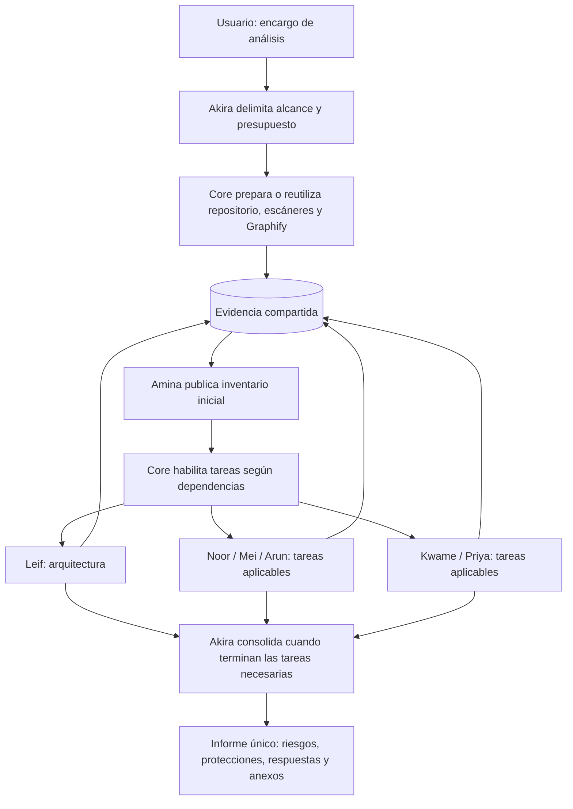

# Plan de evolución: coordinación centralizada y oficina

Fecha: 30/10/2026. Estado: propuesta para revisión; no implementa cambios en ejecución ni animación.

## Decisiones posteriores para el cierre

El usuario solicita cerrar y publicar la versión actual antes de cualquier cambio de interfaz o arquitectura. Se preparará un commit y un pull request sin fusionarlo. Los cambios siguientes quedan para otra versión:

- Ejecución secuencial según dependencias: Inventario publica primero; Arquitectura reutiliza esos hechos; los especialistas siguientes reciben las referencias pertinentes. Este orden facilita la reutilización, pero no garantiza por sí solo un menor consumo.
- Ante un fallo, detener las tareas que dependan del resultado ausente. Continuar solo con tareas independientes y aportaciones válidas. Los fallos globales de acceso, autenticación del proveedor o presupuesto detienen nuevas llamadas; no se reintenta indefinidamente ni se gasta el presupuesto restante sin propósito.
- Panel compacto de ejecución, en cuadrícula: nombre de la persona primero y rol debajo; indicador animado solo mientras ejecuta; modelo, tiempo y tokens disponibles; resultado resumido y error breve visible. El clic abre detalles. No presentar un prompt completo en la tarjeta.
- Cada especialista incorporado tendrá avatar, escritorio y consulta. Akira se sienta al trabajar o responder y se levanta al finalizar o quedar disponible.
- Corregir asientos y reducir los paseos de ocio aproximadamente a un tercio.

Estas decisiones sustituyen las recomendaciones anteriores de aplicar cambios visuales antes del cierre y de activar concurrencia en la siguiente implementación. El resto del documento conserva alternativas y detalles de diseño para revisión; sus referencias al paralelismo no representan el alcance aprobado para el siguiente paso.

## 1. Decisión propuesta

Conservar el resultado actual y cerrar una versión estable antes de cambiar el sistema de ejecución. Incorporar primero las correcciones de presentación y actividad de la oficina. Desarrollar después la evidencia compartida, el catálogo de especialistas y la ejecución concurrente en una versión posterior.

La arquitectura será centralizada: Akira asigna tareas y consolida; Core administra acceso a evidencia, estados, límites y ejecución. Los especialistas publican resultados consultables, sin conversaciones permanentes entre todos.

La recomendación aplica a nuestro proyecto los resultados de Google; el estudio no evaluó este repositorio, no determina nuestro número óptimo de agentes ni garantiza ahorro de tokens.

Referencia: https://research.google/blog/towards-a-science-of-scaling-agent-systems-when-and-why-agent-systems-work/

## 2. Qué existe y qué debe cambiar

- Tres contenedores: `office` presenta la interfaz; `audit-api` ejecuta Core/Hermes y los escáneres; `preparator` prepara Graphify.
- `./reports` está montado como `/reports` en Core y conserva informes, estados y caché de preparación.
- `./artifacts/local-inputs` está montado como `/local-inputs`, de solo lectura, en Core para las capturas locales. El código extraído utilizado en una ejecución también puede vivir temporalmente en `/tmp` de Core.
- El frontend consulta la API de Core; no necesita leer directamente una base de conocimiento ni el repositorio.
- Los especialistas actuales se ejecutan secuencialmente y publican JSON. No existe todavía la base compartida propuesta.
- `write_json` utiliza un nombre temporal fijo por archivo. No es suficiente lanzar varios trabajadores que actualicen el mismo estado sin coordinar sus escrituras.
- El frontend, la proyección de actividad y partes de la planificación contienen identificadores fijos de los cuatro personajes actuales.
- El mapa compacto tiene cuatro escritorios. El crecimiento requiere adaptar el espacio y sus recorridos.
- La simulación tiene pausas de ocio de 4–10 segundos; la síntesis activa una reunión visual. El dibujo combina posiciones de asiento, orientación y profundidad: estos elementos deben comprobarse juntos para corregir las superposiciones.

La revisión realizada para este plan es de código. El defecto de asiento debe reproducirse visualmente y verificarse después de corregirlo; aquí no se da por resuelto.

## 3. Dónde centralizar la información

Propuesta dentro del montaje persistente que ya existe:

```text
Host: arktic_office/reports/       <-> Core: /reports/
  .preparation-cache/                  Capturas derivadas, Graphify y escáneres reutilizables
  .knowledge/
    office.sqlite                     Proyectos, revisiones, hechos, tareas, estados y eventos
    artifacts/<revision-key>/         Resultados grandes y mapas, con referencias y huellas
  <fecha>/<proyecto>/<run-id>/
    job.json                          Compatibilidad con el formato actual
    estado.json                       Proyección exportada; no escritura directa de trabajadores
    celulas/                          Exportaciones compatibles de los resultados
    agents/<agent-id>/
      assignment.json                 Encargo, alcance y presupuesto
      notes.md                        Notas de esta investigación
      result.json                     Resultado estructurado para Core
      summary.md                      Resultado legible para consultas
    informe.html
    informe.md
```

Estas rutas nuevas son una propuesta, no una descripción del contenido actual. Los datos guardados ahí sobreviven al recrear el contenedor porque están en un montaje del host. Esto no constituye por sí solo una copia de seguridad.

SQLite será la fuente de estado y relaciones. Los archivos grandes permanecerán fuera de la base, referenciados desde ella. Core será el propietario de las escrituras y exportaciones, usando transacciones breves; los agentes usarán consultas delimitadas mediante Core. No necesitan ejecutar SQL arbitrario ni modificar carpetas ajenas.

No se añade Redis ni un cuarto contenedor en esta etapa. Se revisaría esa decisión si pasamos a múltiples instancias de Core o trabajadores distribuidos; SQLite requiere un volumen local adecuado y no se presupone válido para escrituras distribuidas sobre cualquier almacenamiento compartido.

### Información compartida

- **Proyecto y revisión:** identidad del repositorio, commit, huella de captura y versiones de herramientas.
- **Evidencia:** archivo, rango de líneas, huella y procedencia. Los fragmentos entregados a modelos conservan las protecciones de redacción de secretos.
- **Hechos:** observaciones concretas de inventario y arquitectura, con referencias; separados de hipótesis y conclusiones.
- **Cobertura:** comprobaciones solicitadas, responsable y resultado: revisada, no aplicable con motivo, pendiente o bloqueada.
- **Hallazgos y protecciones:** condiciones, alcance, evidencia y agentes que los aportaron; las discrepancias se conservan.
- **Trabajo:** tareas, dependencias, consultas, presupuesto, duración, llamadas y uso de tokens comunicado por el proveedor.
- **Eventos:** cambios de actividad que alimentan el frontend y permiten detectar trabajo interrumpido.

Los resultados se vinculan a su revisión. El mismo nombre de proyecto no basta para reutilizarlos. Los derivados deterministas se invalidan por cambios relevantes de código, herramientas o reglas; las conclusiones de modelos también dependen del encargo y la versión de instrucciones. Cambiar un modelo no obliga a regenerar Graphify. La actualización de información externa de vulnerabilidades tiene una política de vigencia independiente del commit.

Compartir un resumen no sustituye la evidencia original. Un especialista puede utilizarlo para localizar un recorrido y consultar después el código necesario para sustentar su conclusión. No se inyectarán todos los informes en todos los prompts.

## 4. Catálogo y puestos de trabajo

| ID propuesto | Persona | Especialidad | Activación |
| --- | --- | --- | --- |
| coordinator | Akira | Coordinación y consolidación | Cada encargo y consulta que requiera coordinación |
| inventory | Amina | Inventario de tecnologías y servicios | Publica una base inicial; reutilizable cuando sea válida |
| architecture | Leif | Arquitectura, entradas y recorridos | Cuando el encargo necesita relacionar componentes y flujos |
| identity | Noor | Identidad, permisos y sesiones | Operaciones con acceso o datos sensibles; también comprobar ausencia de controles necesarios |
| frontend-security | Mei | Seguridad del navegador | Componentes y recorridos de navegador incluidos en el alcance |
| backend-security | Arun | Seguridad del servidor | Backend, funciones, rutas de servidor y acciones de servidor presentes en el alcance |
| devops | Kwame | Despliegue, infraestructura y coste | Despliegue, configuración y riesgos de consumo; Azure cuando proceda |
| data | Priya | Protección y persistencia de datos | Tratamiento de datos relevante para el encargo |
| validation | Zola | Contraste de un hallazgo concreto | Solo bajo encargo explícito; fuera de la ejecución habitual |

Los IDs son propuestos. Se conservará la lectura de informes con el antiguo especialista `security`; no se renombrarán los registros históricos sin una migración definida.

Cada personaje incorporado tendrá escritorio propio, posición estable, avatar, nombre, especialidad, panel y consulta por la API. El mapa contemplará ocho puestos habituales y un noveno reservado para Zola. Su activación visual no implica mantener un proceso o una llamada al modelo permanentemente abiertos.

El catálogo será único para backend y frontend. Las condiciones de activación no se basarán únicamente en nombres de carpetas: por ejemplo, una aplicación denominada frontend puede contener rutas de servidor o llamar a APIs externas. Toda comprobación relevante debe quedar asignada o excluida con motivo.

## 5. Flujo de ejecución



Las ramas representan trabajo elegible, no la obligación de arrancar todos los agentes simultáneamente. Arquitectura puede publicar avances y desbloquear tareas sin terminar su informe completo.

Core tendrá una cola con dependencias y comenzará con un máximo configurable de dos especialistas simultáneos. Se ampliará a tres si memoria, procesos y límites del proveedor lo permiten. El Core actual tiene un límite de 1 GB y no se presupone que varias instancias de Hermes quepan sin medición.

Cada especialista mantiene dentro de su tarea el recorrido completo que necesita investigar. No fragmentaremos cada paso de una misma comprobación entre agentes diferentes.

### Consultas y terminación

1. El especialista solicita un hecho o una referencia a Core.
2. Core consulta la base común y devuelve solo el material pertinente.
3. Si hace falta nueva investigación, registra una tarea acotada para el responsable; evita ciclos de dependencia y encargos duplicados.
4. El especialista termina con resultado, exclusión justificada, bloqueo concreto o error técnico.

Habrá límites globales y por tarea de tiempo, llamadas, tokens disponibles y consultas delegadas. La contabilidad solo puede usar las métricas que entregue el proveedor; se detendrán nuevas llamadas al alcanzar el presupuesto y se documentarán las limitaciones de los límites duros que el proveedor no admita. Un reinicio no relanzará automáticamente una llamada cuyo estado remoto sea desconocido.

No se incorpora una segunda revisión automática, corrección automática de citas ni la batería de casos conocidos descartadas anteriormente. Se mantiene la validación actual de referencias y esquemas.

## 6. Oficina y actividad visible

La fuente de verdad será la actividad real de la tarea, separada del resultado del informe.

| Actividad real | Representación |
| --- | --- |
| Sin tarea o no convocado | De pie o descansando; paseos ocasionales |
| Encargo en cola | Esperando, sin aparentar ejecución |
| Leyendo, consultando o llamando al modelo | Va a su escritorio y se sienta |
| Esperando a otro especialista, sin trabajo ejecutable | Se levanta; indicador de espera |
| Completado | Se levanta; conserva el resultado en el panel |
| Bloqueado o error | Deja de aparentar trabajo y muestra el motivo |
| Nueva pregunta aceptada y en ejecución | Vuelve a su escritorio; se sienta hasta finalizar |

Akira se sentará al preparar encargos, consolidar o responder una consulta. Mientras los especialistas trabajan, si no tiene una tarea propia activa, estará disponible de pie. La síntesis no convocará automáticamente una reunión ni moverá al resto del equipo. Una reunión visual necesitará un evento explícito.

Las consultas al coordinador podrán producir tareas para especialistas dentro del presupuesto autorizado. Si una pregunta llega con un trabajo activo, se registrará en cola y se mostrará como tal: no se fingirá que está ejecutándose. Una desconexión se mostrará como estado desconocido, sin inventar actividad nueva.

### Asientos y movimiento

- Revisar el anclaje de cada asiento, el destino accesible, la orientación del personaje y el orden de dibujo respecto al mueble.
- En los sofás, mostrar al personaje sentado mirando al frente, sin ocultarlo detrás del respaldo. En escritorios, orientar al monitor.
- Reservar asientos para evitar superposiciones. Si todos están ocupados, esperar en un punto libre; no seleccionar un asiento ocupado como alternativa.
- Reducir aproximadamente a un tercio los desplazamientos de ocio. Primer ajuste: pasar las pausas de 4–10 a 12–30 segundos y comprobar la frecuencia efectiva de los recorridos; ajustar si no cumple el objetivo.
- Mantener la velocidad de caminar y la prioridad de ir a trabajar. Reducirla a un tercio haría que pasaran más tiempo andando.
- La animación no genera llamadas al modelo.

### Paneles

Mostrar nombre, actividad, modelo y esfuerzo, duración medida, tokens informados y resultados resumidos. Separar ejecución, cobertura e incidencias de validación. Retirar de la tarjeta principal las instrucciones del rol y los avisos técnicos genéricos; conservar los detalles relevantes desplegables. Los datos históricos ausentes se mostrarán como no disponibles.

## 7. Fases y alcance

| Fase | Entregable | Tamaño relativo | Dependencias |
| --- | --- | --- | --- |
| 0. Punto de control | Revisar cambios actuales, guardar estado estable y métricas de referencia | Pequeño | Ninguna; no cambiar la arquitectura |
| 1. Oficina actual | Asientos, ocio reducido, coordinación visual y tarjetas limpias; tiempos por agente | Pequeño–medio | Fase 0; mantiene los tres especialistas actuales |
| 2. Evidencia compartida | SQLite, referencias, tareas, hechos y exportaciones compatibles | Medio–alto | Contratos de datos e invalidación definidos |
| 3. Planificación concurrente | Cola, dependencias, presupuestos, cancelación y estado consistente | Alto | Fase 2; revisar seguridad de concurrencia de adaptadores y límites de recursos |
| 4. Especialistas y escritorios | Catálogo, responsabilidades, preguntas, avatares, mapa y paneles | Medio–alto | Fases 2–3; incorporación gradual |
| 5. Consultas delegadas | Hablar con Akira, reutilizar hechos y encargar investigaciones acotadas | Medio–alto | Fases 3–4 |
| 6. Comparación y cierre | Comparar consumo, tiempo, cobertura y hallazgos sobre el mismo alcance | Medio | Implementación estable |

Los tamaños son relativos, no estimaciones en días. Las fases 2–5 constituyen un cambio de arquitectura, no un ajuste de prompts.

## 8. Comprobaciones de aceptación

- Los informes existentes siguen abriendo y descargándose en HTML y Markdown.
- La fase visual no cambia el contenido de los análisis ni dispara nuevas llamadas al modelo.
- Cada personaje activo dispone de escritorio y puede abrir su panel; se verifican visualmente sofás, escritorio de Akira y recorridos con varios personajes.
- Akira se sienta por trabajo real, se levanta al terminar y vuelve a sentarse al ejecutar una consulta nueva.
- No hay reunión ni desplazamientos del equipo por una síntesis ordinaria.
- Dos tareas simultáneas no pierden eventos, pisan resultados ni comparten presupuesto por error.
- Un error de especialista no impide guardar las aportaciones válidas del resto.
- Las referencias no cruzan revisiones del repositorio; los cambios de reglas invalidan los derivados correspondientes.
- El mismo commit y preparación compatible permiten reutilizar Graphify; no obligan a reutilizar conclusiones de un análisis distinto.
- Ninguna tarea queda investigándose indefinidamente: se cumplen límites y se identifica qué falta.
- El informe consolida hallazgos de preguntas e investigaciones adicionales, conserva protecciones comprobadas y mantiene el máximo de diez riesgos en el resumen, sin ocultar otros hallazgos en el detalle.
- La comparación del resultado nuevo con el actual usa el mismo repositorio y alcance. Se registran tiempo, tokens, duplicaciones y cobertura; una bajada de tokens con pérdida de cobertura no cuenta como mejora.

Estas comprobaciones verifican el cambio de ejecución e interfaz; no incorporan la batería de aplicaciones vulnerables descartada.

## 9. Límites de acceso

Las herramientas de los especialistas se limitan por Core: lectura de código capturado, consultas a Graphify, resultados y referencias compartidas. No se concede consola general ni escritura sobre el repositorio original por añadir un escritorio o una especialidad.

El aislamiento efectivo de red requiere configuración de red o proxy; no se consigue con instrucciones al modelo. El Core actual no tiene una lista de destinos salientes permitidos que lo limite exclusivamente a modelos. Una restricción de salida deberá conservar explícitamente las conexiones necesarias para proveedores y servicios de análisis autorizados, y tratarse como trabajo específico si se exige antes de la siguiente versión.

## 10. Recomendación de cierre

Cerrar la versión actual después de la fase 1 y de sus comprobaciones. Guardar primero un punto de control del estado existente, que tiene cambios sin confirmar. No modificar de golpe el sistema estable para introducir todos los especialistas.

La siguiente versión incorporará fases 2–3 y después especialistas gradualmente. Se activarán más agentes cuando aporten cobertura o reutilización medible, no para llenar escritorios. El cambio se declarará más eficiente solo cuando la comparación sostenga esa conclusión.
