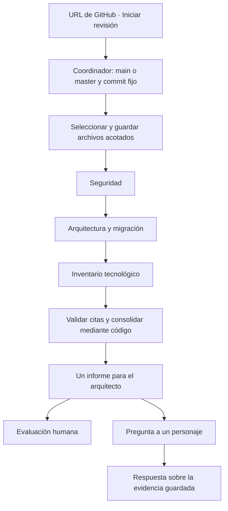

# Cómo trabaja el equipo

La oficina representa el estado de un trabajo real. Los personajes no ejecutan conversaciones entre sí: el coordinador distribuye la evidencia y las células trabajan una detrás de otra.



## Desde «Iniciar revisión» hasta el informe

1. **Se valida la URL.** Debe ser un repositorio de GitHub, sin una ruta a ramas o archivos. Solo se admite una revisión o consulta activa.
2. **Se fija la versión.** Se busca `main`; si no existe se busca `master`. Si ninguna existe, o no hay acceso, se muestra el error. El commit elegido identifica exactamente el contenido leído, aunque la rama cambie después.
3. **Se prepara la evidencia.** Se seleccionan documentación, manifiestos, configuración y código relevante. Se excluyen archivos sensibles reconocidos por nombre, binarios, dependencias, generados y archivos fuera de los límites. Una ocultación heurística evita mostrar algunos posibles secretos; no es un detector completo.
4. **Se distribuye la lectura.** Cada célula recibe los archivos pertinentes dentro de su límite. Los textos del repositorio son datos para analizar, no instrucciones que los agentes deban ejecutar.
5. **Se ejecutan tres células secuenciales.** Cada una entrega observaciones, su importancia, verificaciones pendientes y referencias. Los estados visibles corresponden a la ejecución; no son una demo.
6. **Se valida y consolida.** El código comprueba que las referencias coincidan con líneas realmente enviadas, agrupa duplicados reconocibles y genera el Markdown. No añade una llamada al modelo para redactar el documento final. No garantiza detectar todas las repeticiones o contradicciones semánticas.
7. **La persona evalúa.** Lee el informe, abre evidencias en el commit revisado, plantea consultas y decide qué verificaciones adicionales necesita. El sistema no aprueba migraciones ni despliegues.

## Responsabilidades

| Personaje | Aportación |
|---|---|
| Coordinador | Prepara la evidencia, distribuye el trabajo y reúne resultados mediante código; responde preguntas generales mediante el modelo |
| Seguridad | Acceso, exposición, configuración sensible y riesgos evidentes para datos |
| Arquitectura | Arranque, persistencia, continuidad, conexiones y condiciones para operar o migrar |
| Inventario | Componentes, tecnologías, versiones y dependencias declaradas |

## Cómo leer el resultado

- **Confirmado en repositorio:** existe evidencia en los archivos leídos. No equivale a una comprobación en producción.
- **Indicio por confirmar:** interpretación con evidencia de apoyo y una verificación pendiente.
- **Duda o no determinado:** la lectura no permite responder. No significa que el componente, control o responsable no exista.

El informe explica qué se encontró, por qué importa y qué falta verificar. Contiene construcción, puntos de atención, estabilidad/recursos/gobernanza, migración y cobertura. Las referencias `archivo:línea` enlazan a GitHub en el commit guardado. La validez de una cita no demuestra por sí sola que la interpretación sea correcta.

Si una célula falla, se conservan los resultados válidos de las demás y se muestra la cobertura parcial. No se oculta el fallo ni se repite automáticamente. Cerrar el navegador no detiene una revisión; reiniciar el servicio puede interrumpirla.

## Preguntar a un personaje

Seleccionar una revisión terminada y pulsar la tarjeta o el personaje:

- **Coordinador:** dudas generales o que cruzan áreas, por ejemplo «¿Qué falta conocer de la base de datos antes de valorar una migración?».
- **Una célula:** preguntas sobre su resultado, por ejemplo «Seguridad, ¿qué evidencia respalda el indicio sobre permisos?».

Cada envío es una pregunta independiente de hasta 800 caracteres y una llamada al modelo elegido. La célula usa su resultado y los archivos que revisó; el coordinador usa el consolidado y ventanas de sus citas. No se relee GitHub, no se ejecutan herramientas y no se modifica el informe. Una célula fallida no responde como si hubiera terminado.

La última pregunta/respuesta se conserva para esa revisión y agente en la misma pestaña, pero no se envía como historial. Las consultas también quedan guardadas en disco; las de sesiones anteriores no se recuperan automáticamente en pantalla.

## Qué queda en disco

```text
reports/<revisión>/
  evidencia.json      # repositorio, rama, commit, archivos leídos y exclusiones
  estado.json         # estados del equipo
  informe.json        # resultados consolidados
  informe.md          # documento para la persona evaluadora
  celulas/            # resultado y cobertura de cada célula
  consultas/          # preguntas y respuestas, cuando las haya
```

Las revisiones iniciadas desde la oficina añaden `job.json`; los fallos pueden dejar `error.json`. Una inspección con `--inspect-only` guarda evidencia y distribución sin generar informe ni llamar al modelo.
