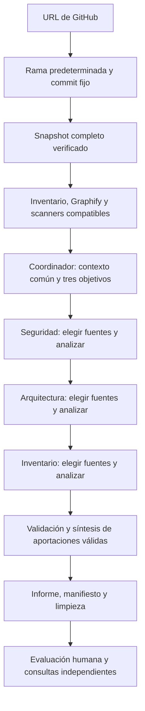

# Cómo trabaja el equipo

La oficina representa un trabajo real. El coordinador asigna objetivos y los especialistas trabajan consecutivamente; no se representan conversaciones inventadas.



## Desde «Iniciar revisión» hasta el informe

1. **Validar la URL y configuración.** Repositorio GitHub y una sola revisión o consulta activa.
2. **Fijar el commit de la rama predeterminada real.** El recorrido híbrido verifica todo su snapshot, sin descargar el historial. Contenido incompleto, LFS/submódulos sin hidratar o capacidad excedida detienen la preparación.
3. **Preparar evidencia sin modelos.** Inventario y herramientas sobre toda su entrada compatible, con ocultación heurística de credenciales y cobertura explícita. El repositorio analizado no se ejecuta.
4. **Asignar objetivos.** Una llamada del coordinador da tres encargos sobre contexto común acotado, sin seleccionar archivos.
5. **Investigar y analizar por especialidad.** Cada especialista consulta el mismo snapshot/grafo bajo sus límites. Una ronda agrupada por defecto y otra opcional si está configurada. Los textos son datos, nunca instrucciones del repositorio.
6. **Validar y sintetizar.** Core contrasta citas con el texto entregado y conserva aportaciones válidas; el coordinador sintetiza en una llamada solo si las hay. Citas válidas no garantizan interpretación semántica correcta.
7. **Guardar y evaluar.** Informes Markdown/HTML, manifiesto, cobertura y trazas; limpieza de temporales completos. La persona revisa las evidencias y decide qué verificar. El sistema no aprueba despliegues.

Detalles y presupuestos: [preparación](PREPARACION.md) y [coordinación](COORDINACION.md). El recorrido `legacy` conserva compatibilidad con adquisición selectiva; no equivale al híbrido completo.

## Responsabilidades

| Personaje | Aportación |
|---|---|
| Coordinador | Prepara la evidencia, distribuye el trabajo y reúne resultados mediante código; responde preguntas generales mediante el modelo |
| Seguridad | Acceso, exposición, configuración sensible y riesgos evidentes para datos |
| Arquitectura | Arranque, persistencia, continuidad y propuesta DevOps Azure sencilla, con supuestos y validaciones |
| Inventario | Componentes, tecnologías, versiones y dependencias declaradas |

## Cómo leer el resultado

- **Confirmado en repositorio:** existe evidencia en los archivos leídos. No equivale a una comprobación en producción.
- **Indicio por confirmar:** interpretación con evidencia de apoyo y una verificación pendiente.
- **Duda o no determinado:** la lectura no permite responder. No significa que el componente, control o responsable no exista.

El informe explica qué se encontró, por qué importa y qué falta verificar. Contiene construcción, puntos de atención, estabilidad/recursos/gobernanza, migración y cobertura. Las referencias `archivo:línea` enlazan a GitHub en el commit guardado. La validez de una cita no demuestra por sí sola que la interpretación sea correcta.

Si una célula falla, se conservan los resultados válidos de las demás y se muestra la cobertura parcial. No se oculta el fallo ni se repite automáticamente. Cerrar el navegador no detiene una revisión; reiniciar el servicio puede interrumpirla.

Si falta información, la célula termina con «Información insuficiente», explica el motivo y qué necesita; no queda trabajando ni se representa como un error técnico. Cuando existen aportaciones válidas y limitaciones, se entrega un resultado parcial. El reporte omite apartados vacíos y concentra las carencias en «Resultado y siguiente paso». Los errores técnicos reales siguen siendo visibles.

## Preguntar a un personaje

Seleccionar una revisión terminada y pulsar la tarjeta o el personaje:

- **Coordinador:** dudas generales o que cruzan áreas, por ejemplo «¿Qué falta conocer de la base de datos antes de valorar una migración?».
- **Una célula:** preguntas sobre su resultado, por ejemplo «Seguridad, ¿qué evidencia respalda el indicio sobre permisos?».

Cada envío es una pregunta independiente de hasta 800 caracteres y una llamada al modelo elegido. La célula usa su resultado y los archivos que revisó; el coordinador usa el consolidado y ventanas de sus citas. No se relee GitHub, no se ejecutan herramientas y no se modifica el informe. Una célula fallida no responde como si hubiera terminado.

La última pregunta/respuesta se conserva para esa revisión y agente en la misma pestaña, pero no se envía como historial. Las consultas también quedan guardadas en disco; las de sesiones anteriores no se recuperan automáticamente en pantalla.

## Qué queda en disco

```text
reports/<revisión>/
  evidencia.json      # repositorio, rama, commit, archivos leídos y exclusiones
  estado.json         # estados del equipo
  informe.json        # resultados consolidados
  informe.md          # documento para la persona evaluadora
  informe.html        # reporte visual imprimible (formato 3)
  celulas/            # resultado y cobertura de cada célula
  consultas/          # preguntas y respuestas, cuando las haya
```

Las revisiones iniciadas desde la oficina añaden `job.json`; los fallos pueden dejar `error.json`. Una inspección con `--inspect-only` guarda evidencia y distribución sin generar informe ni llamar al modelo.

El formato 3 prioriza riesgos con gravedad y certeza separadas, controles pendientes y comprobaciones automáticas. Detalles y límites: [Seguridad](SEGURIDAD.md).

La propuesta Azure se genera en la misma llamada de Arquitectura y se conserva separada de los hallazgos: no acredita compatibilidad ni autoriza despliegues. Prioriza una opción principal; si falta información, señala el destino pendiente. Los ejemplos marcados como simulación contienen datos inventados, no llaman a modelos y no admiten consultas.

Todos los agentes reciben el [estándar de comunicación](ESTANDAR_COMUNICACION_INFORMES.md) desde una única fuente: reglas comunes más su sección. El informe sigue el recorrido resumen → diagnóstico → mejoras → anexos. La consolidación organiza aportaciones válidas, conserva fuentes y discrepancias y registra la versión del estándar. El detalle técnico se abre desde el resumen; los datos que no se aportaron permanecen explícitamente pendientes.
